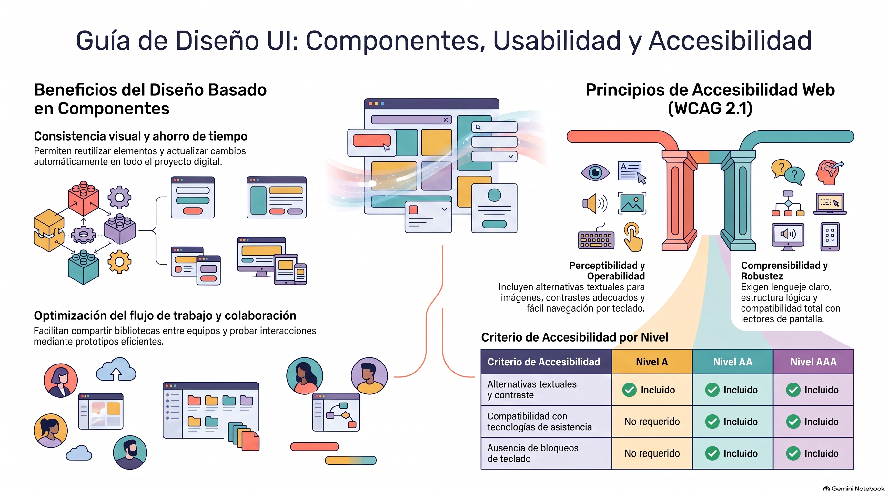

# Semana 1 — Aprendiendo a crear componentes de diseño
**Prototipos Navegables (DUD2204) · Experiencia 1**
**Clase sincrónica:** Miércoles 21 de octubre de 2026 · 19:00 hrs

---

---

> 🎨 **Tutorial práctico de la semana:** [tutorial-figma.md](tutorial-figma.md) — paso a paso para crear variables, el botón y la card de producto en Figma.

---

## Introducción

Bienvenidos a la primera experiencia de **Prototipos Navegables**. En asignaturas anteriores adquiriste habilidades en diseño de interfaces: levantamiento de brief, investigación de usuarios, organización de contenidos con técnicas de **arquitectura de información** y creación de **wireframes**. También desarrollaste conocimientos de diseño **responsive** para adaptar la interfaz a múltiples dispositivos.

Todo ese trabajo es parte del **Diseño Centrado en el Usuario (DCU)**: un proceso **iterativo** que busca una experiencia satisfactoria según los objetivos y lineamientos del proyecto. Este bimestre avanzamos a las etapas de **prototipado y evaluación**.

Durante este bimestre aprenderemos a crear **interfaces interactivas** mediante **componentes**, usando software de diseño y prototipado (**Figma**), y a realizar entregas que consideren la **usabilidad** y la **accesibilidad**. Los componentes te ayudarán a construir interfaces que siguen principios de usabilidad y criterios de accesibilidad, para entregarlas al equipo de desarrollo **Front-end**.

> 💡 **Preguntas activadoras**
> - ¿Sabías que puedes crear componentes en un software de prototipado?
> - ¿Cómo se puede crear una guía de estilo efectiva que incluya criterios de accesibilidad y usabilidad?
> - ¿Cómo influye el diseño de los componentes en la accesibilidad y la usabilidad de una interfaz?

---

## Resultado de Aprendizaje e Indicadores de Logro

**RA1.** Implementar prototipo interactivo de un proyecto digital, considerando códigos gráficos y elementos de usabilidad y accesibilidad.

| IL | Indicador |
|----|-----------|
| **IL1** | Utiliza componentes para el diseño de una interfaz interactiva, de acuerdo a la experiencia de usuario y requerimientos del proyecto. |
| **IL2** | Utiliza elementos gráficos para la correcta composición de un diseño de interfaz, aplicando interacciones y considerando elementos de accesibilidad y usabilidad. |

---

## Conceptos Clave de la Semana

`Usabilidad` · `Accesibilidad` · `Componentes` · `WCAG 2.1` · `Leyes de Nielsen` · `WAI` · `Entrega accesible`

---

## Contenidos

### 1. Usabilidad y Accesibilidad

Son dos conceptos que debemos considerar en **todas** las fases de un proyecto digital: desde el levantamiento hasta los testeos finales.

**Usabilidad:** facilidad con que los usuarios pueden interactuar con un producto, sistema o aplicación y lograr sus objetivos de manera **eficiente, efectiva y satisfactoria**. Una **debilidad de usabilidad** es cualquier aspecto que dificulte o entorpezca la experiencia, y que puede causar menor eficiencia, frustración o dificultad para lograr los objetivos.

**Accesibilidad web:** acceso universal a la Web, independientemente del tipo de hardware, software, infraestructura de red, idioma, cultura, localización geográfica y capacidades de los usuarios.

De esta idea nace la **WAI (Web Accessibility Initiative)**, una iniciativa del **W3C** que busca facilitar el acceso de las personas con discapacidad: desarrolla pautas de accesibilidad (las **WCAG**) y mejora las herramientas para evaluar y reparar la accesibilidad web.

> 🔗 Revisa en el CRAED (con tu usuario Duoc) las definiciones de usabilidad y accesibilidad: [craed.cl/usabilidad](https://craed.cl/usabilidad/)

---

### 2. Las 10 Leyes Heurísticas de Nielsen

Principios propuestos por **Jakob Nielsen**, experto en usabilidad. Son pautas para diseñar interfaces efectivas y amigables, y las usaremos durante todo el bimestre para evaluar nuestros diseños.

| # | Ley | Qué significa |
|---|-----|---------------|
| 1 | **Visibilidad del estado del sistema** | El sistema mantiene informado al usuario de lo que ocurre, con retroalimentación en un tiempo razonable. |
| 2 | **Coincidencia entre el sistema y el mundo real** | Usa lenguaje y conceptos familiares para el usuario, no terminología técnica confusa. |
| 3 | **Control y libertad del usuario** | El usuario puede deshacer acciones no deseadas o salir de situaciones no deseadas. |
| 4 | **Consistencia y estándares** | Elementos y acciones consistentes que siguen estándares reconocidos, para aprenderlos y usarlos fácil. |
| 5 | **Prevención de errores** | El diseño previene errores o minimiza su impacto, con mensajes claros y opciones de recuperación. |
| 6 | **Reconocimiento en lugar de recuerdo** | Información y opciones claras y visibles, sin obligar al usuario a recordar información previa. |
| 7 | **Flexibilidad y eficiencia de uso** | Atajos y opciones para usuarios avanzados, sin complicar a los menos experimentados. |
| 8 | **Diseño estético y minimalista** | Interfaz agradable que muestra solo la información relevante y evita la sobrecarga visual. |
| 9 | **Ayudar a reconocer, diagnosticar y recuperarse de errores** | Cuando hay un error, mensajes claros y opciones para entenderlo y resolverlo. |
| 10 | **Ayuda y documentación** | Ayuda contextual y documentación de fácil acceso cuando el usuario la necesita. |

> 🔗 Video recomendado: [Conoce los principios (leyes) del diseño UX UI](https://www.youtube.com/watch?v=9FxIt_XlLn8)

---

### 3. Componentes en el Diseño de Interfaces

Un **componente** es un elemento visual **reutilizable** que se usa para construir la interfaz de usuario: botones, menús desplegables, campos de entrada, gráficos, tablas, entre otros.

Los componentes **estandarizan** la apariencia y la funcionalidad de la interfaz, lo que simplifica crear diseños coherentes y fáciles de usar. Además, se pueden **combinar** para crear diseños más complejos.

**Un componente bien diseñado:**
- Es fácil de usar y de entender para el usuario.
- Tiene una apariencia consistente.
- Cumple con lo que el usuario espera de su funcionalidad.

Quien diseña debe considerar los requisitos de cada componente y cómo se integra en la interfaz completa.

---

### 4. Ventajas de Crear Componentes

| Ventaja | Descripción |
|---------|-------------|
| **Consistencia visual** | Botones, barras de navegación y campos de entrada se ven iguales en todas las pantallas. |
| **Ahorro de tiempo** | Se reutilizan sin rediseñar. Si cambias el componente, se actualiza en **todas** sus instancias. |
| **Eficiencia en el flujo de trabajo** | Una biblioteca de componentes permite arrastrar y soltar elementos sin recrearlos. |
| **Colaboración y versionado** | El equipo comparte la misma biblioteca, y los cambios se pueden rastrear y versionar. |
| **Pruebas y prototipado** | Con componentes reutilizables se prueban interacciones y flujos más rápido, y se valida antes. |

> 📌 La guía menciona Adobe XD como ejemplo de herramienta. En este curso trabajamos en **Figma**, que tiene las mismas capacidades: componentes, variantes, bibliotecas compartidas e historial de versiones.

> 🎬 Antes de la clase, revisa el video [Creando nuestro primer componente](https://videosduoc.duoc.cl/media/t/1_h0uuogrd) y los recursos sobre Figma del **CRAED**.

---

### 5. Elementos Constitutivos de una Interfaz Web

Varían según el sitio, pero hay elementos comunes que conviene construir como **componentes**:

| Elemento | Qué contiene |
|----------|--------------|
| **Encabezado (header)** | Logotipo, menú principal y, a veces, inicio de sesión o búsqueda. |
| **Barra de navegación** | Enlaces a las distintas partes o secciones del sitio. |
| **Contenido principal** | Texto, imágenes, videos y elementos informativos o interactivos. |
| **Barra lateral** | Enlaces relacionados, menús desplegables, widgets. |
| **Pie de página (footer)** | Información adicional, enlaces útiles, contacto, políticas y términos. |
| **Botones y enlaces** | Acciones: enviar formularios, abrir ventanas, descargar, navegar. |
| **Formularios** | Campos de texto, casillas, botones de opción y de envío. |
| **Menús desplegables** | Listas de opciones que se despliegan al hacer clic. |
| **Imágenes y multimedia** | Imágenes, videos, gráficos o animaciones. |
| **Navegación secundaria** | Enlaces o menús para moverse dentro de una página o hacia contenido relacionado. |
| **Íconos y elementos de diseño** | Redes sociales, indicadores de estado, barras de progreso. |

> 🎬 Video del CRAED: [Desarrollando los componentes pertenecientes al header](https://craed.cl/desarrollando-los-componentes-pertenecientes-al-header/)

---

### 6. Criterios de Accesibilidad (WCAG 2.1)

El **W3C** definió en las **WCAG 2.1** criterios de accesibilidad organizados en tres niveles de cumplimiento:

| Nivel | Descripción |
|-------|-------------|
| **A** | Requisitos mínimos. |
| **AA** | Nivel de referencia que exige la normativa chilena (junto con el A). |
| **AAA** | Nivel máximo de accesibilidad. |

**Normativa en Chile:** las **Leyes 21.180** y **20.422** establecen las WCAG 2.1 como referencia para la accesibilidad de sitios web y aplicaciones móviles del sector público y privado. Por eso debemos aplicar **todos los criterios de éxito de nivel A y AA**.

Los criterios se agrupan en cuatro principios:

| Principio | Ejemplos de criterios |
|-----------|----------------------|
| **Perceptible** | Alternativas textuales para imágenes, videos y todo contenido no textual que entregue información. Colores y contraste adecuados. |
| **Operable** | Tiempo suficiente para leer y usar el contenido. Evitar diseños que causen convulsiones o sean demasiado estimulantes. Navegación clara y consistente. |
| **Comprensible** | Lenguaje claro y sencillo. Ayudas para navegar y orientarse (menús claros y estructurados). Estructura de página lógica y coherente. |
| **Robusto** | Contenido compatible con tecnologías de asistencia (lectores de pantalla, teclado). HTML y CSS válidos y semánticos. |

La guía incluye una **tabla comparativa** que muestra qué criterios exige cada nivel (alternativas textuales, contraste de color, navegación, lenguaje claro, compatibilidad con tecnologías de asistencia, entre otros). Revísala en el PDF de la semana.

**Valores de referencia que usaremos en el curso** (complemento a la guía):
- Contraste de texto normal: **4,5:1** (AA). Texto grande: **3:1**.
- Área táctil de elementos interactivos: **44 × 44 px**.
- Texto alternativo en toda imagen informativa.
- Estado de foco visible para quien navega con teclado.
- No usar el color como único indicador de información.

> 🔗 Profundiza: [Criterios de accesibilidad web (CRAED)](https://craed.cl/criterios-de-accesibilidad/) · [Pautas WCAG 2.1 (W3C)](https://www.w3.org/TR/WCAG21/) · [Verificador de contraste WebAIM](https://webaim.org/resources/contrastchecker/)

---

### 7. ¿Cómo crear un prototipo con criterios de accesibilidad?

La accesibilidad se considera **desde las primeras fases** del diseño. Cuando el diseño está listo, se hace **una copia del proyecto** y sobre ella se agregan notas que explican al equipo de desarrollo cómo implementar la accesibilidad. Es una **entrega accesible**:

| Paso | Qué se hace |
|------|-------------|
| **1. Establecer una simbología** | Definir los elementos gráficos (etiquetas, números, colores) que usarás para declarar la accesibilidad del diseño. |
| **2. Indicar el orden de tabulación** | Con el elemento «orden tab», numerar el recorrido que hará quien navega con la tecla **Tab**. |
| **3. Definir los encabezados** | Marcar la jerarquía de títulos: qué es `h1`, `h2`, `h3`… |
| **4. Indicar los vínculos** | Señalar los links y **anclas** de la página y hacia dónde llevan. |

---

### 8. Buenas prácticas para el diseño accesible

- **Nombrar las mesas de trabajo (frames):** nombres claros que indiquen su función.
- **Indicar regiones y roles:** dividir el sitio en regiones (*landmarks*), asignarles un rol y definir el orden lógico de navegación. Por ejemplo: `role="banner"` para el encabezado y `role="navigation"` para el menú. Lista completa: [Roles WAI-ARIA (MDN)](https://developer.mozilla.org/en-US/docs/Web/Accessibility/ARIA/Roles).
- **Describir cada imagen:** numerar la imagen con una nota y escribir su descripción; será el atributo `alt` en HTML. Ejemplo: «Gato mirando a la cámara de frente».
- **Declarar las imágenes decorativas:** también se indican, aclarando que son **decorativas** (en HTML llevan `alt` vacío).

> 💡 En Figma puedes hacer estas notas con **comentarios** o con **anotaciones** (Dev Mode). En la semana 2 las aplicarás a tu landing page.

---

## Actividad de la Semana

> 📝 **AF1: Utilizando componentes para desarrollar un ecommerce** · Cuestionario en AVA

Leerás un breve caso y responderás preguntas sobre cómo crear componentes para una interfaz atractiva, funcional y fácil de usar. Con esta actividad aprenderás a crear componentes, usarlos en tus diseños y explicar su función en un diseño accesible, mediante una entrega detallada al equipo de desarrollo.

- 📅 **Fecha límite:** Lunes 26 de octubre de 2026 a las 23:59 hrs
- 📤 **Entrega:** Cuestionario directo en la plataforma AVA (sin archivo ZIP)
- 🔗 Recursos Figma disponibles en el **CRAED**

---

## Cierre de Semana

Esta semana vimos la importancia de los **componentes** en el diseño de interfaz. Nos sirven para:

- **Consistencia visual:** ayuda a cumplir los criterios de usabilidad y accesibilidad, porque la interfaz es coherente y, por lo tanto, robusta.
- **Ahorro de tiempo** de diseño y de desarrollo.
- **Facilitar los testeos.**
- **Mejorar el flujo de trabajo** con elementos reutilizables.

También vimos cómo hacer una **entrega que explica los criterios de accesibilidad**. Esta buena práctica simplifica el traspaso al equipo de desarrollo (o a ti mismo, si desarrollas), porque deja claros desde el inicio los criterios que se aplicarán en el código.

Ahora te invitamos a crear tus primeros componentes con el [tutorial de la semana](tutorial-figma.md).

---

## Referencias de la guía

- BrandWarm. *Accesibilidad y leyes en Chile, ¿existe un marco regulador?* Medium.
- BrandWarm. *Accesibilidad y semántica, van de la mano.* Medium.
- Ideas Digitales Aplicadas (2013). *¿Cuál es la relación entre Accesibilidad Web y Responsive Web Design?* Idablog.
- Márquez, P. (2022). *Accesibilidad y diseño UX.* Medium.
- Núñez, M. (2021). *Usabilidad.* Biblioteca Duoc UC. [craed.cl/usabilidad](https://craed.cl/usabilidad/)
- Senadis. *Ley n.º 20.422, normas sobre igualdad de oportunidades e inclusión social de personas con discapacidad.*
- Travé, J. (2019). *Usabilidad y accesibilidad van de la mano.* Eunoia Digital.

---
[📌 Ver Presentación de la Clase](material-clase/presentacion.pdf)

---
[📌 Descargar design system figma](https://drive.google.com/file/d/1t31mBw4CLYYZhbLMFGRHOgjF70iisTKe/view?usp=sharing)

---
