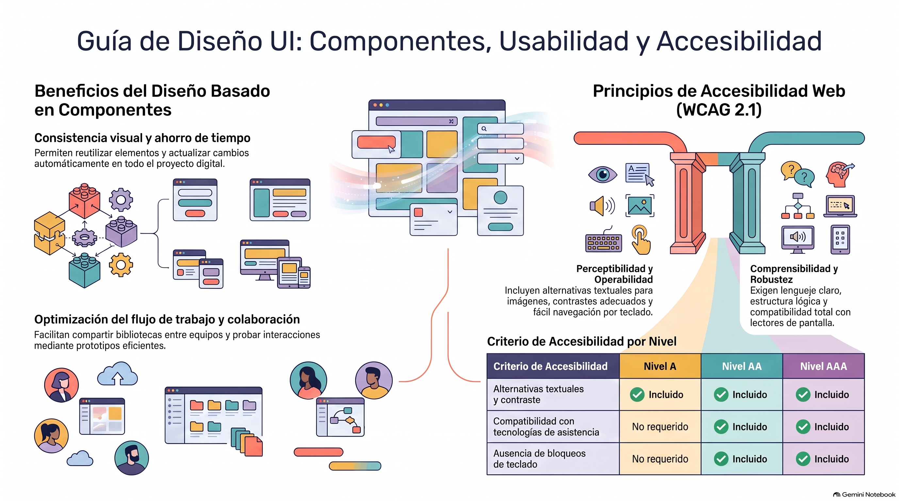

# Semana 1 — Aprendiendo a crear componentes de diseño
**Prototipos Navegables (DUD2204) · Experiencia 1**
**Clase sincrónica:** Miércoles 21 de octubre de 2026 · 19:00 hrs

---

---

## Introducción

Bienvenidos a la primera experiencia de **Prototipos Navegables**. En asignaturas anteriores adquiriste habilidades en diseño de interfaces: levantamiento de brief, investigación de usuarios, arquitectura de información y wireframes. También desarrollaste conocimientos en diseño responsive.

Durante este bimestre aprenderemos a crear **diseños de interfaces interactivas** mediante componentes usando software de prototipado (Figma), y abordaremos cómo realizar entregas considerando la **usabilidad** y **accesibilidad**. Los componentes te ayudarán a construir interfaces siguiendo principios de usabilidad y criterios de accesibilidad para entregarlos al equipo de desarrollo Front-end.

> 💡 **Preguntas activadoras:** ¿Sabías que puedes crear componentes en un software de prototipado? ¿Cómo se puede crear una guía de estilo efectiva que incluya criterios de accesibilidad y usabilidad? ¿Cómo influyen los componentes en la accesibilidad de una interfaz?

---

## Resultado de Aprendizaje e Indicadores de Logro

**RA1.** Implementar prototipo interactivo de un proyecto digital, considerando códigos gráficos y elementos de usabilidad y accesibilidad.

| IL | Indicador |
|----|-----------|
| **IL1** | Utiliza componentes para el diseño de una interfaz interactiva, de acuerdo a la experiencia de usuario y requerimientos del proyecto. |
| **IL2** | Utiliza elementos gráficos para la correcta composición de un diseño de interfaz, aplicando interacciones y considerando elementos de accesibilidad y usabilidad. |

---

## Conceptos Clave de la Semana

`Usabilidad` · `Accesibilidad` · `Componentes` · `WCAG 2.1` · `Leyes de Nielsen` · `WAI`

---

## Contenidos

### 1. Usabilidad y Accesibilidad

**Usabilidad:** facilidad con que los usuarios pueden interactuar con un producto, sistema o aplicación y lograr sus objetivos de manera **eficiente, efectiva y satisfactoria**. Una debilidad de usabilidad es cualquier aspecto que dificulte o entorpezca la experiencia del usuario.

**Accesibilidad Web:** acceso universal a la Web, independientemente del tipo de hardware, software, infraestructura de red, idioma, cultura, localización geográfica y capacidades de los usuarios.

La **WAI (Web Accessibility Initiative)** es una actividad del W3C que facilita el acceso de personas con discapacidad, desarrollando las **pautas WCAG**.

> 📌 En Chile las normativas que regulan la accesibilidad digital son las **Leyes 21.180** (Transformación Digital del Estado) y **20.422** (igualdad de oportunidades e inclusión social de personas con discapacidad). Exigen el cumplimiento de WCAG 2.1 nivel AA.

---

### 2. Las 10 Leyes Heurísticas de Nielsen

| # | Ley | Descripción resumida |
|---|-----|---------------------|
| 1 | **Visibilidad del estado del sistema** | Retroalimentación adecuada en tiempo razonable |
| 2 | **Relación sistema/mundo real** | Lenguaje familiar, no terminología técnica |
| 3 | **Control y libertad del usuario** | Poder deshacer acciones no deseadas |
| 4 | **Consistencia y estándares** | Elementos y acciones consistentes con estándares |
| 5 | **Prevención de errores** | Diseño que minimiza o previene errores |
| 6 | **Reconocer antes que recordar** | Información visible, sin requerir recordar |
| 7 | **Flexibilidad y eficiencia** | Atajos para usuarios avanzados |
| 8 | **Diseño estético y minimalista** | Solo información relevante, sin sobrecarga visual |
| 9 | **Ayuda a recuperarse de errores** | Mensajes claros y opciones de resolución |
| 10 | **Ayuda y documentación** | Ayuda contextual y documentación accesible |

> 🔗 Video recomendado: [Conoce los principios (leyes) del diseño UX UI](https://www.youtube.com/watch?v=9FxIt_XlLn8)

---

### 3. Componentes en el Diseño de Interfaces

Un **componente** es un elemento visual **reutilizable** que se utiliza para construir la interfaz de usuario. Pueden ser botones, menús desplegables, campos de entrada, gráficos, tablas, entre otros.

Los componentes estandarizan la apariencia y funcionalidad de la interfaz, simplificando la creación de diseños coherentes y fáciles de usar. Se pueden combinar para crear diseños más complejos.

**Un componente bien diseñado debe:**
- Ser fácil de usar y entender
- Tener apariencia consistente con el resto de la interfaz
- Cumplir con las expectativas del usuario en cuanto a funcionalidad

---

### 4. Ventajas de Crear Componentes

| Ventaja | Descripción |
|---------|-------------|
| **Consistencia visual** | Apariencia coherente en toda la interfaz — mismos botones, mismos cards |
| **Ahorro de tiempo** | Reutilización sin re-diseñar. Cambios en el maestro se propagan automáticamente |
| **Eficiencia en el flujo** | Biblioteca de componentes para arrastrar y soltar rápidamente |
| **Colaboración** | Todo el equipo usa los mismos elementos; cambios rastreables |
| **Prototipado ágil** | Crear y testear interacciones con componentes reutilizables |

---

### 5. Elementos Constitutivos de una Interfaz Web

Los siguientes elementos son comunes en interfaces web y deben construirse como **componentes** en el software de diseño:

- **Encabezado (Header):** logotipo + menú principal + login/búsqueda
- **Barra de navegación:** links a secciones del sitio
- **Contenido principal:** texto, imágenes, videos, elementos interactivos
- **Barra lateral (Sidebar):** contenido adicional, menús secundarios
- **Pie de página (Footer):** información de contacto, links legales, redes sociales
- **Botones y enlaces:** acciones del usuario (enviar, abrir, navegar)
- **Formularios:** campos de texto, checkboxes, selects, botones de envío
- **Menús desplegables:** listas de opciones seleccionables
- **Imágenes y multimedia:** fotos, videos, gráficos, animaciones
- **Íconos y elementos de diseño:** redes sociales, indicadores de estado

---

### 6. Criterios de Accesibilidad WCAG 2.1

La W3C establece tres niveles de cumplimiento:

| Nivel | Descripción |
|-------|-------------|
| **A** | Requisitos mínimos básicos |
| **AA** | Estándar recomendado (obligatorio en Chile) |
| **AAA** | Nivel máximo de accesibilidad |

**Los 4 principios POUR:**

- **Perceptible:** alternativas textuales para imágenes y videos, contraste adecuado
- **Operable:** tiempo suficiente para leer y usar el contenido, navegación por teclado
- **Comprensible:** lenguaje claro, estructura lógica, menus consistentes
- **Robusto:** compatible con tecnologías asistivas, HTML semántico válido

**Buenas prácticas básicas:**
- Contraste mínimo de texto: **4.5:1** (AA) para texto normal / **3:1** para texto grande
- Área táctil mínima: **44×44px** para elementos interactivos
- Alt text en todas las imágenes informativas
- Estados de foco visibles (teclado y lector de pantalla)
- No depender del color como único indicador de información

---

## Actividad de la Semana

> 📝 **AF1: Utilizando componentes para desarrollar un ecommerce** · Cuestionario en AVA

Responde el cuestionario sobre el diseño de componentes y su utilización en el diseño de interfaz. Leerás un breve caso y responderás preguntas sobre cómo crear componentes para una interfaz atractiva, funcional y accesible.

- 📅 **Fecha límite:** Lunes 26 de octubre de 2026 a las 23:59 hrs
- 📤 **Entrega:** Cuestionario directo en la plataforma AVA (sin archivo ZIP)
- 🔗 Recursos Figma disponibles en el **CRAED**

---

## Cierre de Semana

Esta semana sentamos los fundamentos del bimestre: los componentes son la unidad básica de construcción de cualquier interfaz profesional. La usabilidad y la accesibilidad no son "extras" — son los criterios que determinan si un diseño funciona para todos los usuarios. Las 10 leyes de Nielsen son la lente que usaremos para evaluar nuestros diseños a lo largo del semestre.

---

# Tutorial Figma: Componentes del Apple Store

En este tutorial vas a construir, paso a paso, un **botón** y una **card de producto** reutilizables, y los usarás para armar una pantalla. Al final verás cómo un solo cambio actualiza todo el diseño.

**Tiempo estimado:** 45–60 minutos

## Qué vas a aprender

- Organizar un archivo con **páginas** y **frames**.
- Crear **variables de color** y aplicarlas a cualquier elemento.
- Construir un botón con **Auto Layout** y convertirlo en **componente** con **variantes** (Normal y Hover).
- Colocar una **instancia** del botón dentro de una card (**componente anidado**) y reutilizarla en una pantalla.

## Cómo leer este tutorial

Cada paso tiene la misma estructura:

- **Concepto:** qué es lo que vas a usar.
- **Dónde está:** en qué parte de Figma lo encuentras.
- **Haz esto:** las acciones, en orden.
- **Comprueba:** cómo debe verse si lo hiciste bien.
- **Error frecuente:** qué revisar si algo no resulta.

> Figma puede estar en español o en inglés. La primera vez que aparece un nombre se indican ambos, por ejemplo **Relleno / Fill**.

---

## Antes de comenzar: la interfaz de Figma

Todo lo que harás ocurre en tres zonas:

| Zona | Qué contiene | Para qué la usarás |
| --- | --- | --- |
| Panel izquierdo | Páginas, Capas, Recursos (Assets) y el acceso a Variables | Organizar el archivo, ver la jerarquía e insertar componentes |
| Lienzo central | Espacio de trabajo prácticamente infinito | Dibujar frames, textos y componentes |
| Panel derecho | Propiedades del elemento seleccionado (pestañas Diseño y Prototipo) | Medidas, colores, tipografía, Auto Layout, efectos, variantes e interacciones |

> **Si te pierdes, mira el panel derecho.** Siempre muestra las propiedades de lo que tienes seleccionado. Si está casi vacío, no hay nada seleccionado.

---

## Paso 1 — Crear y organizar el archivo

**Meta:** un archivo con dos páginas y un frame de escritorio de 1440 px en cada una.

**Concepto: página.** Una página es una sección interna del archivo, como las pestañas de un cuaderno. Sirve para separar partes del proyecto: componentes, pantallas, prototipos. Una página **no** es una pantalla del producto.

**Concepto: frame.** Un frame es un contenedor. Puede representar una pantalla, una sección, una card o un botón. A diferencia de un rectángulo, un frame puede contener otros elementos y organizarlos.

**Dónde está:** Páginas, en la parte superior del panel izquierdo. La herramienta Frame, en la barra de herramientas o con la tecla **F**.

### Haz esto

1. Abre Figma y pulsa **Nuevo archivo de diseño / New design file**.
2. Haz clic en el nombre del archivo, arriba al centro, y escribe: `Apple Store — Proyecto PI`.
3. En **Páginas**, haz doble clic en «Page 1» y renómbrala `Componentes`. Aquí construirás las piezas reutilizables.
4. Pulsa **+** junto a Páginas y nombra la nueva página `Landing Page`. Aquí armarás la pantalla.
5. Vuelve a **Componentes**, presiona **F** y elige el preset **Desktop** en el panel derecho (o dibuja un frame y escribe W `1440`, H `1100`).
6. En el panel de Capas, haz doble clic en el nombre del frame y escribe `Desktop · Componentes`.
7. Ve a **Landing Page** y repite: frame W `1440`, H `1600`, nombre `Desktop · Landing Page`.

### Comprueba

```
Apple Store — Proyecto PI
├── Componentes
│   └── Desktop · Componentes (1440 × 1100)
└── Landing Page
    └── Desktop · Landing Page (1440 × 1600)
```

> **Error frecuente:** dibujar un rectángulo (R) en lugar de un frame (F). Si en Capas el ícono es un cuadrado y no un numeral (#), es un rectángulo: bórralo y usa F.

> **Tip:** nombra siempre tus capas. Cuando tengas 200 elementos, el nombre será lo único que te permita encontrar algo.

---

## Paso 2 — Variables de color

**Meta:** 8 variables de color en una colección, y un rectángulo que demuestra que el color viene de la variable y no de un HEX escrito a mano.

**Concepto: variable.** Guarda un valor reutilizable, en este caso un color. En lugar de escribir `#0071E3` en cada botón, el botón se conecta a la variable `Color/Acento`. Si cambias la variable, cambia todo lo conectado a ella.

**Concepto: colección.** Agrupa variables relacionadas, como una carpeta.

**Concepto: modo.** Una columna de valores alternativos para las mismas variables, por ejemplo Claro y Oscuro. En este tutorial usarás solo Claro.

**Dónde está:** botón **Variables** en la barra lateral izquierda (ícono hexagonal). Con nada seleccionado, también aparece en el panel derecho como **Variables locales**.

### Haz esto

1. Abre **Variables** y pulsa **Crear colección / Create collection**. Nómbrala `Apple Store · Colores`.
2. Haz doble clic en la columna **Mode 1** y renómbrala `Claro`.
3. Pulsa **Crear variable → Color** por cada fila de la tabla. Escribe el nombre tal cual, con la barra: `Color/Acento` crea automáticamente el grupo «Color».
4. Escribe el valor HEX en la columna Claro.

| Nombre | Valor | Dónde se usa |
| --- | --- | --- |
| `Color/Primario` | #000000 | Elementos de marca en negro puro |
| `Color/Secundario` | #F5F5F7 | Fondos de áreas de imagen y secciones |
| `Color/Acento` | #0071E3 | Botones y enlaces |
| `Color/Acento Hover` | #0077ED | Botón al pasar el cursor |
| `Color/Texto` | #1D1D1F | Títulos y texto general |
| `Color/Texto suave` | #6E6E73 | Precios y textos secundarios |
| `Color/Texto sobre acento` | #FFFFFF | Texto encima de un botón azul |
| `Color/Fondo` | #FFFFFF | Fondo de cards y pantallas |

5. Cierra Variables. En el frame `Desktop · Componentes` presiona **R** y dibuja un rectángulo.
6. Con el rectángulo seleccionado, ve a **Relleno / Fill** en el panel derecho y pulsa el ícono de variables (hexágono) junto al color.
7. Elige `Apple Store · Colores → Color/Acento`.

### Comprueba

El rectángulo es azul y en Relleno aparece el nombre `Color/Acento` dentro de una pastilla, no un HEX suelto. Cuando termines, borra el rectángulo: solo era una prueba.

> **¿Por qué hay dos variables blancas?** `Color/Fondo` y `Color/Texto sobre acento` valen lo mismo hoy, pero cumplen funciones distintas. Si mañana agregas un modo Oscuro, el fondo pasa a negro y el texto del botón debe seguir blanco. El nombre describe **el uso**, no el color. Eso es una **variable semántica**.

> **Detalle de diseño:** Apple no usa negro puro para el texto general, sino `#1D1D1F`. Se percibe menos duro y más elegante.

> **Error frecuente:** pegar el HEX directamente en el relleno. Se ve igual, pero no queda conectado a la variable. La prueba es la pastilla con el nombre.

> **Nivel 2 (opcional):** en sistemas de diseño profesionales se usan dos colecciones. «Primitivos» guarda la paleta cruda (`gray/900 = #1D1D1F`, `blue/600 = #0071E3`) y «Semántico» guarda los roles (`Color/Texto`, `Color/Acento`), que en vez de un HEX tienen un alias al primitivo: clic derecho en el valor → **Crear alias**.

---

## Paso 3 — Componente Botón

**Meta:** un componente `Botón/Primario` de 160 × 44 px con dos variantes, Normal y Hover, que cambian solas al pasar el cursor en el prototipo.

**Concepto: Auto Layout.** Hace que un frame acomode su contenido automáticamente: centra el texto, mantiene el espaciado y se adapta si el texto cambia. Por eso no armamos el botón con un rectángulo y un texto sueltos: serían dos piezas que se desalinean al editar.

**Concepto: componente.** Un elemento principal reutilizable que define estructura, tamaño y estilos. Se reconoce por un **rombo de cuatro partes** en Capas y su nombre en morado.

**Concepto: variante.** Una versión o estado del mismo componente (Normal, Hover, Desactivado). Las variantes viven juntas en un contenedor de borde morado punteado llamado **conjunto de componentes / Component set**.

### Haz esto — el botón

1. Presiona **T**, haz clic dentro de `Desktop · Componentes` y escribe `Comprar`.
2. En el panel derecho: fuente **SF Pro** (si no la tienes, usa **Inter**), tamaño `17`, peso **Regular**. En el color del texto aplica la variable `Color/Texto sobre acento`.
3. Con el texto seleccionado presiona **Shift + A**. Figma lo envuelve en un frame con Auto Layout.
4. En la sección **Auto Layout** del frame: cambia ancho y alto a **Fijo / Fixed** y escribe W `160`, H `44`. Elige la alineación **centro** en la cuadrícula de 9 puntos.
5. **Radio de esquina / Corner radius:** `20`. **Relleno:** variable `Color/Acento`.
6. Renombra el frame en Capas como `Botón`.

**Comprueba:** un botón azul de 160 × 44 con «Comprar» centrado. Si cambias el texto por «Comprar ahora», sigue centrado.

### Haz esto — el componente y su variante

7. Selecciona el frame `Botón` y presiona **Ctrl + Alt + K** (Windows) o **Option + Cmd + K** (macOS). Renómbralo `Botón/Primario`.
8. En el panel derecho, en la sección del componente, pulsa **Añadir variante / Add variant** (ícono de rombo con +). Aparece una copia debajo, dentro de un borde morado.
9. Selecciona el borde morado (el conjunto). En **Propiedades**, haz clic en «Property 1» y renómbrala `Estado`.
10. Selecciona la primera variante y escribe en Estado: `Normal`. En la segunda: `Hover`.
11. En la variante **Hover**, cambia el relleno a `Color/Acento Hover`.

### Haz esto — que el hover funcione

12. Selecciona la variante **Normal** y cambia la pestaña del panel derecho de **Diseño** a **Prototipo**.
13. Pulsa **+** en Interacciones y configura: **Al pasar el cursor / While hovering** → **Cambiar a / Change to** → `Hover` → **Smart animate**, `150 ms`.
14. Para probar: selecciona el frame `Desktop · Componentes` y pulsa **Presentar / Present** (ícono de play, arriba a la derecha). Pasa el cursor sobre el botón.

### Comprueba

```
Botón/Primario (conjunto de componentes)
├── Estado=Normal  → Color/Acento        #0071E3  160 × 44
└── Estado=Hover   → Color/Acento Hover  #0077ED  160 × 44
```

> **Errores frecuentes**
> - **La variante no aparece:** el componente no estaba seleccionado al pulsar Añadir variante.
> - **El hover no funciona al presentar:** pusiste la interacción en la variante Hover en vez de en la Normal, o usaste «Navegar a» en lugar de «Cambiar a».
> - **El texto se sale del botón:** el ancho quedó en «Ajustar contenido / Hug». Pásalo a Fijo.

> **¿Por qué 44 px de alto?** Apple recomienda al menos 44 × 44 puntos para todo lo que se toca. WCAG 2.2 pide un mínimo de 24 × 24 px y recomienda 44 × 44 px. Un objetivo táctil cómodo reduce errores.

---

## Paso 4 — Componente Card de producto

**Meta:** un componente `Card/Producto` de 300 px de ancho que contiene una instancia del botón y que crece sola si el nombre del producto ocupa dos líneas.

**Concepto: instancia.** Una copia vinculada al componente principal. Se reconoce por un **rombo vacío**. Recibe los cambios del principal y permite elegir variante (Estado: Normal u Hover).

**Concepto: componente anidado.** Una instancia colocada dentro de otro componente. La card contiene el botón, pero el botón sigue conectado a `Botón/Primario`.

### Haz esto — las piezas

1. Presiona **R** y dibuja un rectángulo W `300`, H `240`. Relleno: `Color/Secundario`. Nómbralo `Imagen`.
2. Presiona **T** y escribe `iPhone Pro`. Tamaño `19`, peso **Bold**, color `Color/Texto`. Nómbralo `Nombre`.
3. Crea otro texto: `Desde $999.990`. Tamaño `17`, peso **Regular**, color `Color/Texto suave`. Nómbralo `Precio`.
4. Abre **Recursos / Assets** en el panel izquierdo, busca `Botón/Primario` y arrástralo al lienzo. En el panel derecho debe decir **Estado: Normal**.

### Haz esto — armar la card con Auto Layout

5. Selecciona `Nombre`, `Precio` y el botón (Shift + clic) y presiona **Shift + A**. En Auto Layout: dirección **vertical**, separación `8`, relleno interno (padding) `20` por los cuatro lados. Nómbralo `Info`.
6. Selecciona `Imagen` e `Info` y presiona **Shift + A**. Dirección **vertical**, separación `0`, padding `0`. Nómbralo `Card de producto`.
7. En el frame `Card de producto`: ancho **Fijo** `300`, alto **Ajustar contenido / Hug**. Relleno `Color/Fondo`. Radio `18`. Activa **Recortar contenido / Clip content**.
8. Selecciona `Imagen` e `Info` y en su ancho elige **Llenar contenedor / Fill container**, para que ocupen los 300 px.
9. Con la card seleccionada, en **Efectos** pulsa **+ → Sombra paralela / Drop shadow**: X `0`, Y `8`, desenfoque `24`, extensión `0`, opacidad `10%`.
10. Selecciona la card completa y presiona **Ctrl + Alt + K** / **Option + Cmd + K**. Nómbrala `Card/Producto`.

### Comprueba

La card mide 300 de ancho y unos 380 de alto. Si escribes un nombre largo, la card crece sin que nada se superponga. En Capas debe verse así:

```
Card/Producto            ◆ componente
├── Imagen
└── Info
    ├── Nombre
    ├── Precio
    └── Botón/Primario   ◇ instancia (Estado=Normal)
```

> **¿Para qué sirve Clip content?** Oculta lo que sobresale del frame. Sin él, la imagen cuadrada tapa las esquinas redondeadas de la card.

> **Errores frecuentes**
> - **Copiaste y pegaste el botón principal** en vez de traerlo desde Recursos. Si dentro de la card ves un rombo relleno, duplicaste el componente: bórralo e inserta una instancia desde Recursos.
> - **La imagen no llega a los bordes:** falta Fill container en su ancho, o el padding de la card no está en 0.

> Los precios son ficticios, en pesos chilenos. Puedes usar los modelos y precios vigentes de apple.com/cl.

---

## Paso 5 — Comprobar la reutilización

**Meta:** ver cómo un solo cambio actualiza tres cards a la vez.

### Haz esto

1. Ve a la página **Landing Page**. Desde **Recursos**, arrastra tres instancias de `Card/Producto` al frame.
2. Selecciónalas y presiona **Shift + A** para alinearlas en fila. Pon la separación en `24`.
3. Cambia los textos de cada card con doble clic:

| Card | Nombre | Precio |
| --- | --- | --- |
| 1 | iPhone Pro | Desde $999.990 |
| 2 | iPhone | Desde $799.990 |
| 3 | iPhone SE | Desde $499.990 |

4. **Prueba del componente:** vuelve a **Componentes**, selecciona la variante Normal de `Botón/Primario` y cambia el radio de `20` a `10`. Regresa a Landing Page: los tres botones cambiaron. Deshaz con **Ctrl/Cmd + Z**.
5. **Prueba de la variable:** abre **Variables** y cambia `Color/Acento` a `#2563EB`. Todos los botones cambian de azul, en ambas páginas. Deshaz.
6. **Prueba de la instancia:** selecciona el botón de una sola card y en el panel derecho cambia Estado a `Hover`. Solo cambia esa card. Vuelve a `Normal`.

### Comprueba

Los textos que editaste en cada card se mantienen después de cambiar el componente principal. Figma conserva esas modificaciones locales (se llaman **overrides**).

---

## Preguntas de comprensión

Intenta responderlas antes de mirar las respuestas al final.

1. Si el cliente decide cambiar el azul de los botones de `#0071E3` a `#2563EB`, ¿cuántos cambios harías sin componentes ni variables? ¿Y con ellos?
2. ¿Qué diferencia hay entre una variable y un componente?
3. ¿Normal y Hover son dos componentes distintos?
4. ¿Por qué decimos que el botón de la card es un componente anidado?
5. ¿Qué heurística de Nielsen aplicas al usar el mismo botón en toda la interfaz?
6. ¿Por qué el botón mide 44 px de alto y no 30 px?

---

## Desafío

Crea al menos **un componente propio** para tu proyecto Apple Store. Requisitos:

- [ ] Usa al menos una variable de color.
- [ ] Tiene Auto Layout.
- [ ] Está convertido en componente.

Ideas si no sabes por dónde empezar:

- **Botón secundario:** fondo `Color/Secundario`, texto `Color/Acento`.
- **Badge «Nuevo»:** texto de 12 px sobre un frame con radio alto y relleno `Color/Acento`.
- **Variante Desactivado** para el botón primario, con opacidad 40%.

---

## Actividad formativa (AF1)

La AF1 es un cuestionario en **AVA** sobre los conceptos de este tutorial. No hay que entregar un archivo: se responde directamente en la plataforma.

- **Puntaje:** 10 puntos.
- **Plazo:** lunes 26 de octubre, 23:59.

Lee el caso y aplica lo que practicaste aquí. Si quieres reforzar, el material del CRAED tiene videos sobre componentes en Figma.

---

## Resumen de conceptos

| Concepto | En una frase | Cómo se reconoce |
| --- | --- | --- |
| Página | Organiza áreas del archivo | Lista en el panel izquierdo |
| Frame | Contenedor de una pantalla o pieza | Ícono # en Capas |
| Variable | Valor reutilizable, como un color | Pastilla con nombre en Relleno |
| Auto Layout | Acomoda el contenido de un frame solo | Ícono de líneas en Capas |
| Componente | Elemento principal reutilizable | Rombo relleno, nombre morado |
| Variante | Estado o versión de un componente | Borde morado punteado |
| Instancia | Copia vinculada al principal | Rombo vacío |
| Componente anidado | Instancia dentro de otro componente | Rombo vacío dentro de un componente |
| Prototipo | Interacciones entre estados o pantallas | Pestaña Prototipo, flechas azules |

## Atajos de teclado

| Acción | Windows | macOS |
| --- | --- | --- |
| Frame | F | F |
| Rectángulo | R | R |
| Texto | T | T |
| Añadir Auto Layout | Shift + A | Shift + A |
| Crear componente | Ctrl + Alt + K | Option + Cmd + K |
| Deshacer | Ctrl + Z | Cmd + Z |
| Ajustar zoom a todo | Shift + 1 | Shift + 1 |

---

## Respuestas

1. Sin ellos, un cambio por cada botón del archivo: con 20 botones, 20 cambios, y es fácil olvidar alguno. Con la variable, **un solo cambio** en `Color/Acento`. Lo comprobaste en el Paso 5.
2. La variable guarda **un valor** (un color). El componente guarda **una estructura completa** (forma, texto, espaciado, estados). El componente usa variables por dentro.
3. No. Son **variantes** del mismo componente, agrupadas en un conjunto.
4. Porque es una **instancia** de `Botón/Primario` colocada dentro del componente `Card/Producto`, y sigue conectada a su principal.
5. La n.º 4, **Consistencia y estándares**: el usuario reconoce el mismo patrón visual y de interacción en todas partes.
6. Porque es un objetivo táctil cómodo que reduce errores. Coincide con el mínimo de Apple (44 × 44 pt) y con el nivel recomendado de WCAG (44 × 44 px).


---
[📄 Ver Presentación de la Clase](material-clase/presentacion.pdf)
---
<a href="material-clase/template-base-design-system.fig" download>Descargar design system figma</a>
