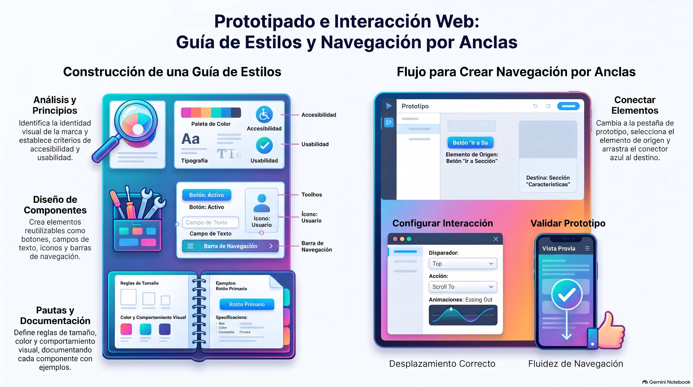

# Semana 2 — Aplicando interacción a un landing page
**Prototipos Navegables (DUD2204) · Experiencia 1**
**Clase sincrónica:** Miércoles 28 de octubre de 2026 · 19:00 hrs

---

---

> 🎨 **Tutorial práctico de la semana:** [tutorial-figma.md](tutorial-figma.md) — guía de estilos, Navbar, Footer, hover y navegación por anclas en Figma.

---

## Introducción

Esta semana veremos cómo crear un **prototipo navegable**, aplicando **interacción** a tu diseño.

El **diseño de interacción** es el proceso de crear interacciones significativas y efectivas entre los usuarios y un sistema digital (una app, un sitio web o un dispositivo interactivo). Se centra en **cómo los usuarios interactúan** con la interfaz y en **cómo el sistema responde** a esas interacciones.

Para construir el prototipo retomaremos las **guías de estilo**, ahora creadas directamente en el software de prototipado mediante **componentes**.

> 💡 **Preguntas activadoras**
> - ¿Sabías que puedes agregar interacción a tu documento?
> - ¿Qué tipos de interacción conoces?

---

## Resultado de Aprendizaje e Indicadores de Logro

**RA1.** Implementar prototipo interactivo de un proyecto digital, considerando códigos gráficos y elementos de usabilidad y accesibilidad.

| IL | Indicador |
|----|-----------|
| **IL1** | Utiliza componentes para el diseño de una interfaz interactiva, de acuerdo a la experiencia de usuario y requerimientos del proyecto. |
| **IL2** | Utiliza elementos gráficos para la correcta composición de un diseño de interfaz, aplicando interacciones y considerando elementos de accesibilidad y usabilidad. |
| **IL3** | Implementa una maqueta de interfaz responsiva para múltiples dispositivos, según los requerimientos del proyecto. |
| **IL4** | Aplica guía de estilo, considerando criterios de accesibilidad y usabilidad. |

---

## Conceptos Clave de la Semana

`Interacción` · `Guía de estilos` · `Landing page` · `Microinteracciones` · `Navegación por anclas`

---

## Contenidos

### 1. ¿Qué es el diseño de interacción?

Es el proceso de **crear y definir cómo los usuarios interactúan con una interfaz digital**: cómo se relacionan con los elementos y funciones de una app, un sitio web u otro producto digital. Su objetivo es una experiencia **intuitiva, eficiente y satisfactoria**, que facilite realizar tareas y lograr objetivos.

Se basa en principios como la **usabilidad**, la **accesibilidad**, la **retroalimentación visual**, la **estructura de la información** y la **respuesta del sistema**. Al diseñar la interacción se consideran la disposición de los elementos, sus comportamientos y transiciones, los **desencadenantes** de acción (clics, deslizamientos, gestos) y el feedback al usuario.

**Aspectos a definir en tu prototipo:**

| Aspecto | Pregunta que responde |
|---------|----------------------|
| **Objetivos de interacción** | ¿Qué acción o resultado espero cuando el usuario interactúa con este elemento? |
| **Flujos de usuario** | ¿Cómo se moverá entre elementos y pantallas? ¿Qué acciones podrá hacer (clic, deslizar, completar formularios)? |
| **Herramientas de prototipado** | ¿Con qué vinculo elementos y creo transiciones? (Figma, InVision, Proto.io) |
| **Estado de los elementos** | ¿Cómo se ve el elemento antes, durante y después de la interacción? |
| **Transiciones y animaciones** | ¿El cambio es un desvanecimiento, un deslizamiento, una expansión? |
| **Feedback y retroalimentación** | ¿Cómo sabe el usuario que su acción funcionó? (mensajes de confirmación, carga, errores) |

---

### 2. La guía de estilo

Antes de prototipar, necesitamos el **diseño**, y para eso hay un elemento fundamental: la **guía de estilo**. Es la herramienta que garantiza **coherencia y consistencia visual**: define las reglas de tipografía, colores, estilos de botones, disposición de elementos y otros aspectos visuales y funcionales.

**¿Por qué importa?** Con una guía de estilo las interfaces son **intuitivas y predecibles**: todas las pantallas se ven uniformes y los elementos interactivos se comportan igual. Así se reduce la curva de aprendizaje del usuario.

#### Elementos básicos de una guía de estilo

| | Elemento |
|--|---------|
| **A** | Familia tipográfica |
| **B** | Pesos tipográficos |
| **C** | Encabezados |
| **D** | Párrafos y alineación de textos |
| **E** | Muestras y paletas primaria y secundaria de colores |
| **F** | Tipos de botones |
| **G** | Tamaños permitidos para imágenes e íconos |
| **H** | Familia iconográfica |

Para diseñarla hay que **conocer al cliente**, su identidad visual y sus usuarios. Se parte por la **tipografía y los colores**, y luego se deciden los tamaños de párrafos y encabezados (la guía muestra el orden de prioridad en su Figura 2).

#### ¿Cómo construir una guía de estilo?

| Paso | Descripción | Qué se diseña |
|------|-------------|---------------|
| **1. Análisis de la marca** | Comprender la marca y su identidad visual. | Colores, tipografía y estilos visuales. |
| **2. Principios de diseño** | Definir los principios: simplicidad, consistencia, accesibilidad y usabilidad. | Diseño general de la interfaz. |
| **3. Diseño de componentes** | Crear botones, íconos, campos de entrada, barras de navegación y otros elementos. | Componentes de la interfaz. |
| **4. Pautas de diseño** | Reglas de uso de cada componente. | Tamaño, posición, color, fuente y comportamiento. |
| **5. Estilo visual** | Un estilo coherente para toda la interfaz. | Estilo visual general. |
| **6. Documentación** | Documentar la guía para que todo el equipo la consulte, con ejemplos visuales. | Descripción de cada componente y pauta. |

> ⚠️ El **test heurístico** y la **accesibilidad** deben considerarse en **todas** las fases.

**En Figma** la guía se construye con **variables** (colores, espaciados), **estilos de texto** (encabezados, párrafos) y **componentes con variantes** (botones en sus estados), en una página dedicada «Guía de estilos». Verifica el contraste de cada combinación de texto y fondo (mínimo **4,5:1**, o **3:1** para texto grande) con el [WebAIM Contrast Checker](https://webaim.org/resources/contrastchecker/).

> 🎬 Video: [¿Cómo hacer una guía de estilos y componentes?](https://www.youtube.com/watch?v=IqlFl-oi7Dg) (Recetas de Diseño Duoc UC; usa Adobe XD, pero los conceptos son los mismos).

---

### 3. Diseño de interacción en el prototipo

El primer paso es **identificar las áreas interactivas**: revisa tu diseño y decide qué elementos responderán al usuario. Pueden ser botones, menús desplegables, enlaces, formularios y elementos deslizantes (*slider*, carrusel), entre otros.

**Desencadenantes y acciones en Figma** (pestaña **Prototipo / Prototype**):

| Desencadenante (trigger) | Uso típico |
|--------------------------|-----------|
| **Al hacer clic / On click** | Botones, links, menús |
| **Al pasar el cursor / While hovering** | Estado hover de botones y cards (vuelve solo al salir) |
| **Al entrar / salir el mouse / Mouse enter / Mouse leave** | Hover con la vuelta definida por separado |
| **Al arrastrar / On drag** | Sliders y carruseles |
| **Tecla / Key/Gamepad** | Atajos de teclado |

| Acción | Qué hace |
|--------|----------|
| **Navegar a / Navigate to** | Lleva a otro frame (otra pantalla) |
| **Desplazarse a / Scroll to** | Se mueve dentro del mismo frame: es la **navegación por anclas** |
| **Cambiar a / Change to** | Cambia la variante de un componente (estados) |

**Animaciones:** instantánea, disolver, **Smart animate** (Figma interpola entre estados), deslizar o empujar. Para la mayoría de las transiciones usa entre **200 y 400 ms**.

> 📌 La guía explica estos pasos en Adobe XD. En el curso usamos **Figma**: los conceptos son los mismos y en clase se muestran con los nombres de Figma.

> 🔗 Recursos de la guía: artículo «Componentes interactivos en Figma: tutorial + qué es» (uifrommars.com) · [Componentes en Figma (blog oficial)](https://www.figma.com/blog/components-in-figma/) · videos de YouTube «Auto Layout en Figma: introducción y ejemplos» y «Figma Tutorial – Creación de componentes».

---

### 4. Navegación por anclas

Un **ancla** vincula una sección de un mismo documento con otra que está más arriba o más abajo. Permite recorrer una landing page **sin salir de la misma mesa de trabajo**, con una navegación lineal parecida a la de un sitio real.

**Paso a paso en Figma:**

1. Abre la pestaña **Prototipo / Prototype** del panel derecho.
2. Selecciona el elemento que vas a vincular (por ejemplo, el link «Productos» del menú). Aparece un conector azul con una flecha.
3. Arrastra el conector hasta la **sección de destino** (debe estar dentro del mismo frame).
4. Define la interacción:
   - **Desencadenante:** al hacer clic (o tap).
   - **Acción:** **Desplazarse a / Scroll to**.
   - **Destino:** la sección o el título hacia donde arrastraste el conector.
   - **Animación:** la más frecuente es *ease in and out* (inicio y final suaves), con su duración.
5. Prueba el prototipo con el botón **Presentar / Present** (▶, arriba a la derecha).

> 🔑 **Navegar a** lleva a otro frame. **Desplazarse a** hace scroll dentro del mismo frame: eso es un ancla.

> 🔗 Para profundizar: video «Especificaciones del prototipo: 3 tipos», en [nngroup.com](https://www.nngroup.com).

---

## Actividad de la Semana

> 📁 **AS1: Creando componentes en un landing page** · Actividad sumativa individual

Tendrás que **rediseñar el line-up (cartelera) del festival Lollapalooza**, tomando como referencia el sitio actual, que no cumple con criterios de usabilidad y accesibilidad. Aplicarás interacciones y componentes para mejorar la experiencia, y entregarás las indicaciones de accesibilidad necesarias para que el diseño se adapte a distintos tamaños de pantalla y dispositivos.

**Pasos del enunciado:**

1. Observa y analiza el sitio actual e identifica mejoras de usabilidad y accesibilidad.
2. Haz un esquema o boceto del rediseño de la cartelera.
3. Crea un proyecto nuevo en Figma.
4. Diseña el **header**, el **nav** y el **footer**, y conviértelos en **componentes** (obligatorio).
5. Diseña la cartelera con la información organizada de forma clara y legible.
6. Añade interacciones para mejorar la experiencia.
7. Agrega **comentarios o anotaciones de accesibilidad** dentro del diseño.
8. Antes de entregar, pruébalo en distintos tamaños de pantalla y dispositivos.

> ⚠️ Revisa las pautas de accesibilidad de la semana 1 para que tu diseño cumpla los estándares.

**Entrega (ambos archivos al AVA):**
1. **ZIP** con el archivo del proyecto (en Figma: **Archivo → Guardar copia local**, genera un `.fig`), con el nombre `PN_S2_NombreApellido.zip`.
2. El **documento del enunciado** con el **enlace de revisión** del diseño pegado donde dice «ingresa aquí la URL». Déjalo con acceso «Cualquier persona con el enlace · Puede ver».

- 📅 **Fecha límite:** Lunes 2 de noviembre de 2026 a las 23:59 hrs
- ⚠️ Esta actividad es **sumativa**: revisa la rúbrica.

---

## Cierre de Semana

Esta semana aprendimos qué es el **diseño de interacción** y creamos nuestra primera **microinteracción** con el efecto ancla. Aspectos clave del diseño de interacción:

- **Comprender a los usuarios:** investigar sus metas, tareas y preferencias antes de diseñar.
- **Definir los objetivos de interacción:** qué acciones o tareas deben poder realizar.
- **Crear flujos de interacción:** diagramas de cómo navegarán, intuitivos y eficientes.
- **Diseñar la arquitectura de información:** jerarquía, navegación y categorización del contenido.
- **Prototipado y testing:** probar las interacciones antes del diseño final.
- **Diseño de microinteracciones:** pequeñas animaciones o respuestas visuales (cambios de color, desvanecimientos, transiciones suaves) que dan feedback.
- **Iteración y mejora continua:** ajustar el diseño con la retroalimentación y el testing.

También vimos los **vínculos de anclaje**, que permiten recorrer una landing sin salir de la misma mesa de trabajo, y recordamos cómo crear una **guía de estilos con componentes** para unificar estilos y dar coherencia visual al proyecto.

---

## Referencias de la guía

- Adobe (2023). *Crear vínculos de anclaje en Adobe XD.*
- Diseño Duoc UC (2021). *Recetas de diseño: ¿Cómo hacer una guía de estilos y componentes en Adobe XD?* [video]. YouTube.
- Accesibilidad para todos (2023). *Aplicando criterios de accesibilidad en el proceso de diseño de interfaz de usuario, guía práctica.* LinkedIn.
- Niceverynice (s.f.). *Patrones y ejemplos de UI/UX de comercio electrónico.* [niceverynice.com](https://www.niceverynice.com/components-categories/ecommerce)

---

[📄 Ver Presentación de la Clase](material-clase/presentacion.pdf)
