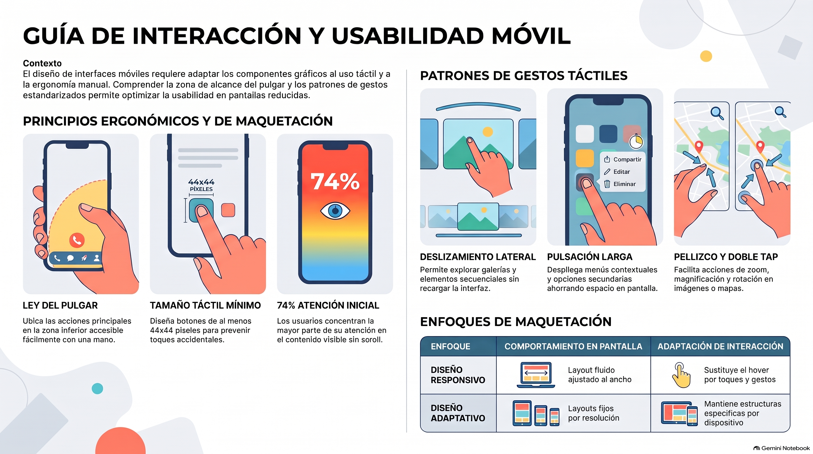

# Semana 3 — Reconociendo patrones de interacción en dispositivos móviles
**Prototipos Navegables (DUD2204) · Experiencia 2**
**Clase sincrónica:** Miércoles 4 de noviembre de 2026 · 19:00 hrs

---

---

> 🎨 **Tutorial práctico de la semana:** [tutorial-figma.md](tutorial-figma.md) — fold, ley del pulgar, áreas táctiles, menú hamburguesa, navegación inferior, carrusel y sticky CTA en Figma.

---

## Introducción

Esta semana iniciamos la **Experiencia 2** estudiando cómo las personas interactúan con interfaces en dispositivos móviles: qué ven primero, cómo sostienen el teléfono, qué gestos usan y qué limitaciones técnicas condicionan el diseño.

El concepto que abre la semana es el **Fold** ("pliegue"). Viene de los diarios impresos: se entregaban doblados y lo que quedaba bajo el pliegue no se veía hasta abrirlos (*below the fold*). En una página web, el Fold es el límite entre lo que se ve en la primera vista y lo que requiere hacer scroll, tanto en móvil como en escritorio.

> 💡 **Preguntas activadoras:** ¿Conoces las interacciones en móviles? ¿Cuáles son los patrones de diseño más utilizados en un diseño de interfaz? ¿Cuáles son las resoluciones más utilizadas en diseño de interfaz?

> 📱 **¿Por qué importa?** A diciembre de 2025, Chile tenía cerca de 24 millones de abonados de telefonía móvil, unos 118 por cada 100 habitantes (Subtel). Para muchos usuarios, la primera vez que vean tu diseño será en un celular.

---

## Resultado de Aprendizaje e Indicadores de Logro

**RA1.** Implementar prototipo interactivo de un proyecto digital, considerando códigos gráficos y elementos de usabilidad y accesibilidad.

| IL | Indicador |
|----|-----------|
| **IL1** | Utiliza componentes para el diseño de una interfaz interactiva, de acuerdo a la experiencia de usuario y requerimientos del proyecto. |
| **IL2** | Utiliza elementos gráficos para la correcta composición de un diseño de interfaz, aplicando interacciones y considerando elementos de accesibilidad y usabilidad. |
| **IL3** | Aplica guía de estilo, considerando criterios de accesibilidad y usabilidad. |
| **IL4** | Compone prototipo interactivo, considerando elementos de accesibilidad y usabilidad. |
| **IL5** | Implementa una maqueta de interfaz responsiva para múltiples dispositivos, según los requerimientos del proyecto. |

---

## Conceptos Clave de la Semana

`Fold` · `Patrones de interacción` · `Patrones de diseño` · `Resolución de pantalla` · `Desplazamientos vertical y horizontal` · `Pruebas de usabilidad`

---

## Contenidos

### 1. Patrones de interacción en dispositivos móviles

En móvil el puntero es un dedo, no un mouse: es menos preciso, tapa lo que toca y depende de la mano que sostiene el teléfono. Por eso la guía propone siete aspectos a considerar al diseñar la interacción:

| Aspecto | Qué significa en la práctica |
|---------|------------------------------|
| **Tamaño de los elementos interactivos** | Botones y enlaces de mínimo **44×44** para tocarlos con precisión y evitar toques accidentales. |
| **Retroalimentación táctil (feedback)** | Al tocar, el elemento debe responder (resaltarse, cambiar de color, animarse) para confirmar que la acción fue reconocida. |
| **Navegación intuitiva** | Usar patrones conocidos (navegación inferior, menú hamburguesa) y una estructura simple, sin sobrecarga de opciones. |
| **Gestos táctiles** | Aprovechar deslizar, pellizcar o tocar con varios dedos de forma coherente y con sentido. |
| **Animaciones y transiciones** | Suaves y sutiles para mostrar cambios de estado y pasar entre pantallas (como referencia, entre 200 y 400 ms). |
| **Entrada de datos eficiente** | Mostrar el teclado adecuado al dato (numérico, fecha, correo) y validar en tiempo real. |
| **Diseño adaptable y sensible** | Que la interfaz se ajuste a distintos tamaños de pantalla y orientaciones, manteniéndose accesible. |

> 🔑 La clave, según la guía: comprender a tus usuarios, hacer pruebas de usabilidad e iterar. Simplicidad, coherencia y eficiencia.

---

### 2. El Fold y el desplazamiento vertical

**El Fold** es la línea imaginaria que separa lo visible al cargar la página de lo que requiere scroll. El **desplazamiento vertical** (scroll hacia arriba y abajo) es la interacción que permite llegar a ese contenido.

- **Sobre el fold:** lo que el usuario ve inmediatamente.
- **Bajo el fold:** lo que solo verá si decide hacer scroll.

Según un estudio de Nielsen Norman Group citado en la guía, **cerca del 74% de la atención se concentra en las primeras pantallas**. Eso no significa que los usuarios no hagan scroll: lo hacen cuando lo de arriba les da una razón.

> ⚠️ **El fold no es una línea fija.** Cambia según el dispositivo, la orientación y, en web, la barra del navegador, que resta espacio visible. Márcalo en Figma según el dispositivo, pero compruébalo siempre en un celular real.

**¿Qué va sobre el fold en un ecommerce móvil?**
- El producto o la propuesta de valor principal (hero).
- El título y el precio.
- El botón de acción principal (CTA).
- Una pista de que hay más contenido.

**¿Cómo motivar el scroll?**
- **Contenido que asoma:** una imagen o tarjeta cortada en el borde inferior indica que la página continúa.
- **Evitar el falso final:** espacios vacíos o líneas horizontales justo en el fold hacen creer que la página terminó.
- **Indicadores:** puntos de paginación, contador de imágenes, "Ver más" cuando corresponda.
- **Priorizar, no comprimir:** reducir tipografías y botones para que "todo quepa" arriba empeora la experiencia.

---

### 3. Patrones de diseño (patrones de lectura)

Existen varios patrones de lectura o escaneo de pantalla: **E, F y Z**. El más usado en móvil es el **patrón F**:

1. El usuario lee una línea horizontal en la parte superior.
2. Baja y lee una segunda línea horizontal, más corta.
3. Escanea el lado izquierdo de la pantalla en línea vertical.

**Implicancias para tu diseño:**
- Lo más importante va **arriba y a la izquierda**.
- Los títulos deben comenzar con la palabra clave ("iPhone 17 Pro: cámara…" funciona mejor que "Descubre todo lo que puedes hacer con…").
- Los bloques de texto se escanean, no se leen: usa títulos, frases cortas y jerarquía clara.

---

### 4. Interacciones y formas de sostener el dispositivo: la ley del pulgar

Normalmente sostenemos el teléfono con una mano y lo operamos con el pulgar. La **ley del pulgar** describe qué zonas de la pantalla son fáciles o difíciles de alcanzar en esa postura.

| Zona | Dónde está | Qué ubicar ahí |
|------|-----------|----------------|
| 🟢 **Fácil** | Parte inferior y centro | CTA principal, navegación frecuente |
| 🟡 **Alcanzable** | Centro y laterales | Contenido, acciones secundarias |
| 🔴 **Difícil** | Esquinas, sobre todo las superiores | Acciones que no queremos que se toquen por accidente (eliminar, regresar) |

**Formas de sostener el móvil** (investigación de Steven Hoober, 2013):

| Forma | Uso aprox. | Implicación para el diseño |
|-------|-----------|----------------------------|
| **Una mano (pulgar)** | ~49% | La zona inferior central es la más accesible. Es el caso que debes priorizar. |
| **Cuna** (una mano sostiene, la otra toca) | ~36% | Mayor alcance y precisión, pero la persona no siempre tiene la otra mano libre. |
| **Dos manos (dos pulgares)** | ~15% | Típico al escribir; ambos lados inferiores son accesibles. |

> 🎯 Los elementos de acción críticos van en la **zona de fácil alcance del pulgar**. El **centro inferior** es la ubicación más segura porque funciona tanto para diestros como para zurdos.

> 🧪 **Pruébalo:** toma tu celular con una mano e intenta tocar la esquina superior del lado contrario sin reacomodarlo. Esa dificultad es la que vivirá tu usuario.

---

### 5. Gestos táctiles

Los gestos son **instrucciones invisibles**: el usuario no puede verlos, solo deducirlos. Por eso todo gesto necesita una **pista visual**, y las acciones importantes necesitan además una **alternativa con un toque simple** (también es un criterio de accesibilidad de las WCAG).

| Gesto | Qué hace | Ejemplo de uso | Cuidado con… |
|-------|----------|----------------|--------------|
| **Tap (toque)** | Acción directa | Botones, enlaces, tarjetas | Es el más claro y accesible |
| **Desplazamiento vertical** | Recorrer el contenido bajo el fold | Home, ficha de producto | El falso final |
| **Desplazamiento lateral** | Ver contenido que no cabe a lo ancho | Filtros, categorías, carruseles | Si nada asoma, el usuario no sabe que hay más |
| **Pulsación larga** | Opciones adicionales sin saturar la interfaz | Menú contextual (guardar, compartir) | Es difícil de descubrir: nunca para la acción principal |
| **Doble toque** | Ampliar una imagen o mapa | Zoom en la foto del producto | Puede chocar con el zoom del navegador |
| **Magnificar / reducir / girar** | Pellizco con índice y pulgar | Mapas, fotos en detalle | Requiere dos dedos: ofrece una alternativa |
| **Deslizar** | Mover, pasar al siguiente, aprobar o descartar | Galerías, sliders, carruseles | Necesita indicador (puntos, imagen asomando) |
| **Deslizar hacia abajo para refrescar** | Recargar | Estándar en Chrome, Safari y Firefox | Ya lo resuelve el navegador |

> 💡 **En táctil no existe el hover.** Lo que en escritorio aparecía al pasar el mouse (submenús, vistas previas, tooltips) debe resolverse con un toque, una pulsación sostenida o un deslizamiento.

---

### 6. Patrones de diseño de interfaz para móvil

| Patrón | Descripción | Cuándo usar |
|--------|-------------|-------------|
| **Menú hamburguesa** | Ícono ≡ que despliega el menú (a menudo como panel lateral o *drawer*) | Navegación secundaria o con muchas secciones |
| **Navegación inferior** | Pestañas fijas abajo | Apps con 3 a 5 secciones principales |
| **Tarjetas con desplazamiento lateral** | Tarjetas que se deslizan horizontalmente | Productos relacionados, destacados |
| **Botón a ancho completo** | Botón que ocupa todo el ancho disponible | CTA principal en pantallas pequeñas |
| **Sticky CTA** | Botón fijo que acompaña el scroll | "Comprar", "Agregar a la bolsa" en la ficha de producto |
| **Deslizar para refrescar** | Recargar arrastrando hacia abajo | Listas con contenido que cambia |
| **Scroll infinito** | Carga más contenido al llegar al final | Feeds y catálogos extensos (evitarlo si hay footer importante) |

> 🍎 **Caso Apple:** la app Apple Store usa navegación inferior, mientras que el sitio apple.com en móvil usa un menú en la cabecera. Una app controla toda la pantalla; en un sitio web el navegador ya ocupa parte de los bordes. Cada decisión de navegación depende de la plataforma y debe justificarse.

---

### 7. Limitaciones técnicas

#### Diseño responsivo vs. diseño adaptativo

| | **Diseño adaptativo** | **Diseño responsivo** |
|---|---|---|
| **Cómo funciona** | Un layout fijo para cada resolución, a partir de la distribución de escritorio | Un layout fluido que se ajusta al ancho del viewport |
| **Resultado** | Varios diseños, uno por tamaño | Un diseño que cambia de forma continua |
| **Interacciones** | Se comparten entre versiones (lo que era hover en escritorio pasa a ser tap) | Tiene interacciones propias: sin hover, con toque sostenido y gestos como deslizar en carruseles |
| **Analogía** | Ropa en tallas S, M y L | Una prenda elástica |

El diseño responsivo va más allá de reacomodar elementos: también implica optimizar la interacción y la navegación en cada dispositivo.

#### Points vs. píxeles físicos

En Figma se trabaja en **points**, no en píxeles físicos. La pantalla multiplica según su densidad (@2x, @3x).

| Dispositivo | Resolución física | Points en Figma | Densidad |
|-------------|-------------------|-----------------|----------|
| iPhone SE (3ª gen) | 750×1334 | 375×667 | @2x |
| iPhone 14 | 1170×2532 | 390×844 | @3x |
| iPhone 14 Pro | 1179×2556 | **393×852** | @3x |
| iPhone 14 Pro Max | 1290×2796 | 430×932 | @3x |
| Samsung Galaxy S22 | 1080×2340 | 360×780 | ~@3x |
| iPad (10ª gen) | 1640×2360 | 820×1180 | @2x |

> ⚠️ Si diseñas en 1179 de ancho "porque es la resolución del iPhone", todo quedará diminuto al probar. Trabaja en **points**.

#### Resoluciones de referencia para prototipos (Figura 12 de la guía)

| Móvil | Points | Tablet | Points |
|-------|--------|--------|--------|
| iPhone 14 Pro Max | 430×932 | iPad Pro 12.9" | 1024×1366 |
| iPhone 14 Pro | 393×852 | iPad Pro 11" | 834×1194 |
| iPhone 14 Plus / 13 Pro Max | 428×926 | iPad Air | 820×1180 |
| iPhone 14, 13, 12 | 390×844 | iPad | 768×1024 |
| iPhone 13 Pro, 12 Pro | 390×844 | iPad mini | 744×1133 |
| iPhone 13 mini | 375×812 | Samsung Galaxy Tab 10 | 800×1280 |
| iPhone X, XS, 11 Pro | 375×812 | Surface Pro 7 | 1368×912 |
| iPhone XR, XS Max, 11 | 414×896 | Surface Pro 8 | 1440×960 |
| Google Pixel 7 Pro | 412×892 | | |
| Google Pixel 7, 6, 6a, 5a | 412×915 | | |
| Samsung Galaxy S10 | 360×760 | | |

> 📐 **Recomendación práctica:** elige una resolución base (en clase usamos **393×852**) y verifica tu diseño en el extremo chico (**360** de ancho) y en el grande (**430** de ancho). Los modelos más recientes tienen medidas distintas, pero el principio es el mismo: usa el preset de Figma del modelo que elijas.

#### Áreas táctiles mínimas

| Referencia | Tamaño mínimo |
|-----------|---------------|
| **Guía del curso** | **44×44** |
| Apple Human Interface Guidelines | 44×44 pt |
| Material Design (Google) | 48×48 dp |
| WCAG 2.2 | 24×24 (mínimo, nivel AA) · 44×44 (nivel AAA) |

> El área táctil no es el ícono: un ícono de 24 puede vivir dentro de un frame tocable de 44×44.

#### Ancho reducido, contenido más largo

En móvil el ancho se reduce, pero el contenido bajo el fold se alarga. Por eso hay que combinar todo lo anterior: patrones de navegación adecuados, elementos interactivos en las zonas que alcanza el pulgar e interacciones pensadas para el uso con una o dos manos.

---

### 8. Pruebas de usabilidad en móviles

Una prueba de usabilidad permite revisar contenidos, patrones de diseño e interacciones con usuarios reales, obtener retroalimentación e **iterar**. Apps como Uber lanzan mejoras constantemente a partir de datos de cómo las personas usan su interfaz.

**Tipos de prueba más utilizados (según la guía):**

| Prueba | Qué evalúa | Ejemplo en tu proyecto |
|--------|-----------|------------------------|
| **Navegación** | Con qué facilidad el usuario llega a donde quiere | "Encuentra los AirPods y entra a su ficha" |
| **Interacción** | Si botones, enlaces y gestos funcionan con fluidez | ¿Descubre el carrusel? ¿Acierta a los íconos? |
| **Accesibilidad** | Si se cumplen los criterios vistos en la guía anterior | Contraste, áreas táctiles, tamaños de texto |
| **Compatibilidad** | Si funciona en distintos dispositivos y sistemas (Android/iOS) y navegadores (*cross browser*: Chrome, Firefox, Edge, Safari) | Probar en al menos dos celulares distintos |
| **A/B testing** | Qué versión funciona mejor para validar una hipótesis | CTA arriba vs. sticky CTA abajo |

> 💡 **Inspiración (referencias de la guía):** revisa patrones reales en [Mobbin](https://mobbin.com), [Niceverynice](https://www.niceverynice.com), Dribbble, Behance y [Sidebar](https://sidebar.io).

**¿Por qué probar específicamente en móvil?**
- Las interacciones táctiles son distintas a las del mouse.
- El contexto de uso cambia: movimiento, luz solar, una mano ocupada.
- La pantalla limita lo que se ve sobre el fold.

**Cómo probar tu prototipo móvil en Figma:**
1. **Present** con marco de dispositivo (iPhone 14 Pro) para revisar en el computador.
2. **Comparte el enlace del prototipo** para que otra persona lo abra en su celular.
3. Usa la **app de Figma** en tu teléfono para ver el prototipo en el dispositivo real.

> 🧪 **Mini prueba recomendada:** pide a dos o tres personas que, **con una sola mano**, encuentren un producto y lleguen al botón de compra. No las ayudes. Anota dónde dudan.

---

## ✅ Checklist para tu rediseño móvil

- [ ] Trabajo en **points** con un frame base (ej. 393×852).
- [ ] Marqué la **línea del fold** y prioricé producto, precio y CTA sobre ella.
- [ ] Hay **contenido que asoma** bajo el fold (sin falsos finales).
- [ ] Todos los elementos interactivos tienen un área de **44×44** como mínimo.
- [ ] El **CTA principal** está en la zona de fácil alcance del pulgar (idealmente un sticky CTA inferior).
- [ ] Cada carrusel tiene una **pista visual** de desplazamiento lateral (tarjeta asomando, puntos).
- [ ] Ninguna acción importante depende solo de un gesto oculto (pulsación larga, doble toque).
- [ ] Nada depende del **hover**.
- [ ] Revisé el diseño en un ancho chico (360) y uno grande (430).
- [ ] Probé el prototipo **en un celular real**.

> 🎨 Practica cada punto de esta lista en el [tutorial Figma de la semana](tutorial-figma.md).

---

## 📝 Autoevaluación (para repasar antes de la AF2)

1. ¿De dónde viene el término Fold y qué significa en una página web?
2. ¿Qué porcentaje aproximado de la atención se concentra en las primeras pantallas, según el estudio citado en la guía?
3. ¿Cuál es el patrón de lectura más usado en móvil y cómo se recorre la pantalla con él?
4. Según la ley del pulgar, ¿dónde ubicarías un botón de "eliminar"? ¿Y el de "comprar"?
5. ¿Qué gesto usarías para mostrar opciones adicionales sin saturar la interfaz?
6. ¿Qué diferencia hay entre diseño responsivo y adaptativo?
7. ¿Qué reemplaza al hover en una interfaz táctil?
8. ¿Cuál es el tamaño mínimo recomendado para un elemento interactivo?
9. ¿Qué tipo de prueba aplicarías para comprobar que tu sitio funciona en Chrome, Firefox y Edge?
10. ¿En qué consiste una prueba A/B?

---

## Actividad de la Semana

> 📝 **AF2: Reconociendo patrones de interacción en dispositivos móviles** · Cuestionario en AVA

Identifica los patrones de interacción para interfaces móviles, reconoce las resoluciones para trabajar un diseño responsivo y planifica qué patrón de interacción corresponde a cada componente (gestos, toques, deslizamientos, entre otros).

- 📅 **Fecha límite:** Lunes 9 de noviembre de 2026 a las 23:59 hrs
- 📤 **Entrega:** Cuestionario directo en la plataforma AVA (sin archivo ZIP)
- 📖 **Cómo prepararte:** lee la guía de aprendizaje completa. Pueden aparecer detalles sobre resoluciones, diseño responsivo y adaptativo, limitaciones técnicas y tipos de pruebas de usabilidad.

---

## Cierre de Semana

Los patrones de interacción móvil no son convenciones arbitrarias: responden a cómo las personas sostienen y operan físicamente sus teléfonos. La ley del pulgar condiciona dónde van los elementos interactivos y de qué tamaño; el fold define qué se prioriza; y los gestos amplían lo que una pantalla pequeña puede hacer, siempre que sean descubribles.

También vimos que el diseño responsivo va más allá de adaptar tamaños: implica optimizar la interacción y la navegación en cada dispositivo, y que las pruebas de usabilidad son la forma de comprobar que nuestras decisiones funcionan. Esta es la base técnica sobre la que construiremos la interfaz responsiva de las próximas semanas.

> 💬 **Tres ideas para llevarte:**
> 1. El fold se diseña priorizando y dejando pistas de que hay más.
> 2. Lo importante va donde llega el pulgar.
> 3. Todo gesto necesita una pista visual y, si es importante, una alternativa con un toque.

---

## Recursos y Referencias

- Nielsen Norman Group — *The Fold Manifesto: How to Encourage Scrolling* (video) · nngroup.com
- Nielsen Norman Group (2012) — *Mobile Usability* (libro) · nngroup.com
- Nielsen Norman Group — Artículos de diseño visual y de diseño de interacción · nngroup.com
- Mobbin — Biblioteca de pantallas reales de apps iOS · mobbin.com
- Niceverynice — Colección de patrones UI/UX · niceverynice.com
- Dribbble y Behance — Inspiración UI/UX
- Sidebar — Selección diaria de enlaces de diseño · sidebar.io
- Apple Human Interface Guidelines · developer.apple.com/design
- Subtel — Informe del Sector Telecomunicaciones (dic. 2025) · subtel.gob.cl

---

[📄 Ver Presentación de la Clase](material-clase/presentacion.pdf)
