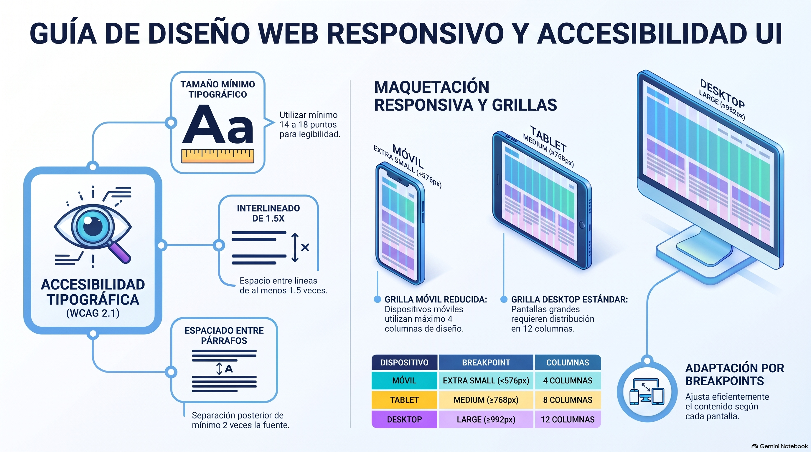

# Semana 4 — Diseñando una interfaz responsiva
**Prototipos Navegables (DUD2204) · Experiencia 2**
**Clase sincrónica:** Miércoles 11 de noviembre de 2026 · 19:00 hrs

---

---

> 🎨 **Tutorial práctico de la semana:** [tutorial-figma.md](tutorial-figma.md) — landing móvil con columnas, estilos accesibles, acordeón, menú overlay y flujos en Figma.

---

## Introducción

Esta semana aprenderemos a usar los **flujos entre mesas de trabajo**, las **interacciones** necesarias y los **componentes** para lograrlo. También aprenderemos a **diagramar** con columnas y a aplicar criterios para que el diseño sea **accesible desde la lectura**.

Según el INE (junio de 2022), en Chile hay **33.437.286 teléfonos móviles**: más de uno por persona. Con ese uso, el diseño responsivo es indispensable. Esta semana aplicamos lo que sabemos al diseño de interfaces móviles y adaptamos el diseño a distintos tamaños de pantalla.

> 💡 **Preguntas activadoras**
> - ¿Puedo probar mi prototipo en un móvil?
> - ¿Cuáles son las resoluciones para diseñar en móvil?
> - ¿Cuántas columnas se ocupan en una mesa de trabajo móvil?
> - ¿Qué tamaño de texto debo usar en mi diseño de interfaz móvil?

---

## Resultado de Aprendizaje e Indicadores de Logro

**RA1.** Implementar prototipo interactivo de un proyecto digital, considerando códigos gráficos y elementos de usabilidad y accesibilidad.

| IL | Indicador |
|----|-----------|
| **IL1** | Utiliza componentes para el diseño de una interfaz interactiva, de acuerdo a la experiencia de usuario y requerimientos del proyecto. |
| **IL2** | Utiliza elementos gráficos para la correcta composición de un diseño de interfaz, aplicando interacciones y considerando elementos de accesibilidad y usabilidad. |
| **IL3** | Aplica guía de estilo, considerando criterios de accesibilidad y usabilidad. |
| **IL4** | Compone prototipo interactivo, considerando elementos de accesibilidad y usabilidad. |
| **IL5** | Implementa una maqueta de interfaz responsiva para múltiples dispositivos, según los requerimientos del proyecto. |

---

## Conceptos Clave de la Semana

`Vista previa` · `Componentes interactivos` · `Accesibilidad` · `Breakpoint` · `Columnas` · `Resolución`

---

## Contenidos

### 1. Diseñar una interfaz responsiva

Un proyecto se diseña **para escritorio y para móvil**. Para hacerlo bien necesitamos tener claros: el uso de las **mesas de trabajo** (frames en Figma), los aspectos gráficos vistos desde la accesibilidad, los componentes, los colores, las **columnas**, los **breakpoints** y las **interacciones móviles**.

**Punto de partida:** pensar siempre en la **resolución mínima** para comenzar a diseñar. Eso entrega las pautas para adaptar el proyecto a cualquier dispositivo. La guía muestra un esquema con las resoluciones mínimas y máximas de las mesas de trabajo (Figura 1). En la actividad de esta semana, la mesa móvil debe tener **mínimo 350 px** de ancho.

---

### 2. Flujos entre mesas de trabajo

Al conectar mesas de trabajo y elementos se forman **flujos**: recorridos de navegación o de animación. En Figma se trabajan en la pestaña **Prototipo / Prototype**:

| # | Idea de la guía | Cómo se ve en Figma |
|---|-----------------|---------------------|
| 1 | Al seleccionar un elemento aparece un **manejador** que se puede arrastrar. | El círculo con «+» que aparece al pasar el cursor sobre un elemento seleccionado. |
| 2 | Puede haber manejadores **desde la mesa de trabajo** y **desde los objetos**, para dos tipos de interacción. | Interacciones en el frame completo (por ejemplo, «Después de un tiempo») y en sus capas (por ejemplo, «Al hacer clic»). |
| 3 | Al arrastrar el manejador hacia otra mesa, se activa el **panel de interacción**. | Se abre el panel de la interacción. |
| 4 | El panel tiene **disparador** (*trigger*), **acción**, **destino** y **animación**. | Desencadenante · Acción · Destino · Animación y duración. |
| 5 | Las mesas conectadas forman un **flujo de trabajo** (*workflow*). | Un **flujo** con su **punto de inicio**. |
| 6 | Un proyecto puede tener **varios flujos**: por ejemplo, para probar dos formas de navegar o dos dispositivos. | Varios puntos de inicio, que se eligen al presentar. |

> 🔑 **Buena práctica:** crea flujos separados para **Mobile** y **Desktop**. Al presentar, cambias de flujo para mostrar cada versión.

---

### 3. Aspectos gráficos

#### Columnas

Las columnas permiten **diagramar** mejor. Se basan en una retícula de **12 columnas**; en móvil se piensa en un máximo de **4 columnas** (la guía usa como ejemplo las columnas de Bootstrap).

#### Tamaños tipográficos accesibles

Las WCAG 2.1 piden que el usuario **pueda ajustar el tamaño de la fuente** en su navegador; no fijan un tamaño único. La guía recomienda trabajar con tamaños mínimos de **14 a 18 puntos**, aproximadamente **1,2 a 1,5 em** (120 % a 150 % del tamaño base del cuerpo).

Ten presente que los tamaños relativos (%, em, rem) dependen del tamaño configurado en el navegador o en el `body` del proyecto. Diseña pensando en que el usuario puede cambiarlos.

> 📌 **En el proyecto del curso** usamos **17 px** para el texto de cuerpo (también en móvil) y reducimos solo los títulos:

| Elemento | Desktop | Mobile |
|----------|---------|--------|
| H1 | 72 px | 40 px |
| H2 | 48 px | 32 px |
| H3 | 28 px | 21 px |
| Cuerpo | 17 px | **17 px (no se reduce)** |

#### Espaciado de texto e interlineado (criterio WCAG 1.4.12, nivel AA)

| Propiedad | Mínimo | Ejemplo con texto de 17 px |
|-----------|--------|---------------------------|
| **Interlineado** | 1,5 × el tamaño de la fuente | 25,5 px (en el curso usamos 28) |
| **Espacio después del párrafo** | 2 × el tamaño de la fuente | 34 px |
| **Espaciado entre letras (tracking)** | 0,12 × el tamaño de la fuente | 2,04 px |
| **Espaciado entre palabras** | 0,16 × el tamaño de la fuente | 2,72 px |

> 💡 El criterio exige que el contenido **siga funcionando** cuando el usuario aplica esos espaciados. Diseñar con ellos en mente evita textos que se cortan o se superponen. La guía muestra un ejemplo donde el espacio entre palabras se triplica (2,88 × 3 = 8,64 pt) para mejorar la legibilidad.

> 🔗 [Espaciado entre texto, nivel AA (W3C)](https://www.w3.org/WAI/WCAG21/Understanding/text-spacing.html)

#### Los paneles que usarás para diseñar

| | Elemento | Para qué sirve |
|--|----------|----------------|
| **A** | **Colores** | Guardar las muestras, ordenadas por tono y contraste (en Figma: **variables**). |
| **B** | **Estilos de caracteres** | Familia, rol (heading, párrafo) y tamaño de cada texto (en Figma: **estilos de texto**). |
| **C** | **Componentes** | Botones, flechas, inputs, cards y todo lo reutilizable. |
| **D** | **Mesa de trabajo** | Su nombre y su resolución. |
| **E** | **Grilla (grid)** | Configurar las columnas de la mesa (en Figma: **guías de diseño / layout guide**). |
| **F** | **Componentes anidados** | Un componente formado por otros (botones, inputs, flechas). |

Todo diseño debe incluir las partes de un sitio web: **header, nav, main y footer**.

---

### 4. Tamaños de pantalla (breakpoints)

Los **breakpoints** (puntos de quiebre) son las resoluciones en que el diseño cambia al pasar de un dispositivo a otro. Trabajar con ellos es un **estándar de la industria**. Cada dispositivo usa una **grilla**:

| Dispositivo | Columnas |
|-------------|:--------:|
| Desktop | **12** |
| Tablet | **8** |
| Móvil | **4** |

Anchos de referencia que usamos en el curso para las mesas de trabajo:

| Mesa de trabajo | Ancho |
|-----------------|-------|
| Mobile S | 375 px (la AF3 pide mínimo 350) |
| Mobile L | 428 px |
| Tablet | 768 px |
| Tablet horizontal | 1024 px |
| Desktop | 1280 px |
| Desktop L | 1440 px |

> 🔗 Prueba cómo cambian las columnas (12 → 8 → 4) al achicar el navegador: [fundaciondigital.cl/breakpoints.html](https://fundaciondigital.cl/breakpoints.html) · Referencia: [Breakpoints de Bootstrap](https://getbootstrap.com/docs/5.2/layout/breakpoints/#available-breakpoints)

---

### 5. Interacciones móviles: el carrusel y el acordeón

La guía enseña a crear un **carrusel** con estados de componente. En Figma se hace con **variantes**:

1. Diseña la estructura del carrusel: un frame con **Recortar contenido / Clip content** (la «máscara») que contiene dos o más imágenes, una visible y la otra fuera del recorte.
2. Conviértelo en **componente**.
3. Crea una **variante** por cada imagen (`Foto 1`, `Foto 2`…). En cada una, mueve las imágenes para que se vea la que corresponde.
4. En la pestaña **Prototipo**, selecciona la variante `Foto 1` y agrega: **Al hacer clic** (tap) o **Al arrastrar** (deslizar) → **Cambiar a** → `Foto 2`.
5. Animación: **Smart animate**, **Ease in and out**, **600 ms** (0,6 segundos, como en la guía).
6. Repite en `Foto 2` hacia `Foto 1`, y prueba con **Presentar**.

El **acordeón** desplegable se construye igual: una variante `Cerrado` y otra `Abierto`, y un toque cambia de una a otra.

| Gesto en móvil | Desencadenante en Figma |
|----------------|------------------------|
| Toque (tap) | Al hacer clic / On click |
| Deslizar | Al arrastrar / On drag |
| Pulsación larga | Mientras se presiona / While pressing |
| Tocar el menú ☰ | Al hacer clic → **Abrir superposición / Open overlay** |

> 🎬 Videos de la guía (en Adobe XD): «Carrusel con Tap» y «Cómo crear un acordeón desplegable». Los recursos de Figma están en el **CRAED**.

---

### 6. Visualización y prueba en el celular

Para revisar el prototipo, usa la **vista previa**: el botón **Presentar / Present** (▶). Ahí navegas y haces las pruebas.

Para probarlo **en tu celular**, descarga la app **Figma** desde App Store o Google Play, abre tu archivo y presenta el prototipo. Así detectas brechas que en el computador no se ven. (La guía lo explica con la app de Adobe XD; en Figma se hace con su propia app.)

En el computador también puedes elegir un **Dispositivo / Device** en la configuración del prototipo, para verlo dentro del marco de un celular.

---

## Actividad de la Semana

> 📁 **AF3: Creando una landing page interactiva y responsiva** · Actividad formativa individual

**Caso:** en Chile, el 50 % de las compras online de 2021 se hizo desde celulares, y a fines de 2022 la cifra llegó al 58 % (Cámara de Comercio de Santiago). Un amigo que está armando una **tienda de distribución de productos Apple** te encarga una **landing responsiva** que muestre un **catálogo de 5 productos** y sea la cara visible de su empresa en internet.

**Características de diseño que debe cumplir:**
- Diseñada en una **resolución móvil**.
- Adaptada a **columnas móviles**, para facilitar la lectura y la navegación.
- **Escalable** a otras resoluciones mediante breakpoints.
- Tamaños tipográficos y **espaciados de texto** con criterios de accesibilidad.
- **Paleta, estilos de caracteres y componentes** coherentes con la identidad de la marca.
- **Interacciones móviles** (toque, deslizar, doble toque…) para mejorar la usabilidad.
- Contenido trabajado **sobre y bajo el fold**.

**Pasos:**
1. Crea una mesa de trabajo móvil de **mínimo 350 px** de ancho.
2. Habilita las **columnas**.
3. Crea la **guía de estilos**: estilos tipográficos, paleta y componentes.
4. Crea los elementos activos usando esos componentes y estilos.
5. Aplica los criterios de accesibilidad en tamaños y espacios.
6. Usa **componentes interactivos**.
7. Prueba con la **vista previa** que se vea y funcione bien en móviles.

**Entrega (ambos al AVA):**
1. **ZIP** con el archivo del proyecto (Figma: **Archivo → Guardar copia local**), con el nombre `PN_S4_NombreApellido.zip`.
2. El documento de la actividad con el **enlace de revisión** del diseño (acceso «Cualquier persona con el enlace · Puede ver»).

- 📅 **Fecha límite:** Lunes 16 de noviembre de 2026 a las 23:59 hrs
- ⚠️ Es **formativa** y tiene rúbrica de retroalimentación.

---

## Cierre de Semana

Esta semana aprendimos:

- La importancia de elegir una **mesa de trabajo adecuada**, partiendo por la resolución mínima.
- A usar los **espaciados de texto** para crear prototipos más accesibles.
- A usar las **columnas** y los **breakpoints** para que la interfaz se adapte al contenido.
- A crear **componentes interactivos** con el panel de prototipo: un carrusel y un acordeón.
- A usar la **vista previa** para probar cómo se ven y funcionan los prototipos.

Ahora cuentas con las herramientas para crear diseños más eficientes y consistentes. ¡Sigue explorando y perfeccionando tus habilidades!

---

## Referencias de la guía

- W3C (s.f.). *Espaciado entre texto (nivel AA).* [w3.org](https://www.w3.org/WAI/WCAG21/Understanding/text-spacing.html)
- Bootstrap (s.f.). *Available breakpoints.* [getbootstrap.com](https://getbootstrap.com/docs/5.2/layout/breakpoints/#available-breakpoints)
- Accesibilidad para todos (2023). *Garantizando la accesibilidad web: la importancia de mejorar la legibilidad del texto.* LinkedIn.

---

[📄 Ver Presentación de la Clase](material-clase/presentacion.pdf)
