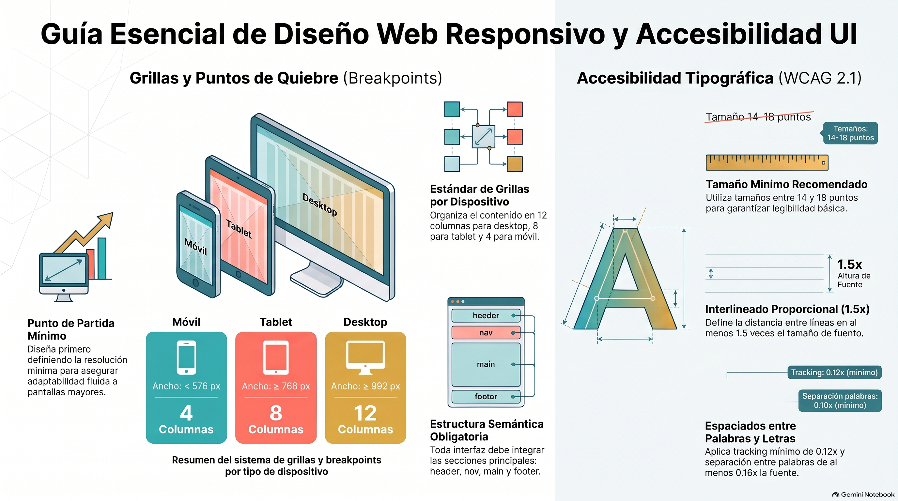

# Semana 5 — Diseñando una interfaz con sistemas de diseño
**Prototipos Navegables (DUD2204) · Experiencia 2**
**Clase sincrónica:** Miércoles 18 de noviembre de 2026 · 19:00 hrs

---



---

> 🎨 **Tutorial práctico de la semana:** [tutorial-figma.md](tutorial-figma.md) — sistema de diseño con Atomic Design, plantillas y páginas interiores en Figma.

---

## Introducción

Esta semana aprenderemos los **elementos fundamentales para iniciar un diseño de interfaz**, los criterios de accesibilidad que debemos considerar durante el proceso y algunas **metodologías** de trabajo.

Partiremos por **cómo iniciar un proyecto de interfaz**: la importancia de una arquitectura sólida y de contar con diagramas de flujo, wireframes, inventario de contenido, componentes y guía de estilo. Luego veremos **Mobile First**, que diseña primero para móviles y después adapta a otras resoluciones; los **sistemas de diseño**, conjuntos de normas para gestionar el diseño a escala con componentes y patrones reutilizables; y la metodología **Atomic Design**, que compone sistemas de diseño combinando átomos, moléculas, organismos, plantillas y páginas.

> 💡 **Preguntas activadoras**
> - ¿Qué elementos debemos tener en cuenta para iniciar un diseño de interfaz?
> - ¿Qué metodologías para diseñar conoces?
> - ¿Cuál es la importancia de los sistemas de diseño?

---

## Resultado de Aprendizaje e Indicadores de Logro

**RA1.** Implementar prototipo interactivo de un proyecto digital, considerando códigos gráficos y elementos de usabilidad y accesibilidad.

| IL | Indicador |
|----|-----------|
| **IL1** | Utiliza componentes para el diseño de una interfaz interactiva, de acuerdo a la experiencia de usuario y requerimientos del proyecto. |
| **IL2** | Utiliza elementos gráficos para la correcta composición de un diseño de interfaz, aplicando interacciones y considerando elementos de accesibilidad y usabilidad. |
| **IL3** | Implementa una maqueta de interfaz responsiva para múltiples dispositivos, según los requerimientos del proyecto. |
| **IL4** | Aplica guía de estilo, considerando criterios de accesibilidad y usabilidad. |
| **IL5** | Compone prototipo interactivo, considerando elementos de accesibilidad y usabilidad. |

---

## Conceptos Clave de la Semana

`Sistemas de diseño` · `Proyecto de interfaz` · `Atomic Design` · `Mobile First`

---

## Contenidos

### 1. ¿Cómo iniciar un proyecto de interfaz?

Antes de diseñar una interfaz (de escritorio o móvil) hay que contar con **todo el sistema de arquitectura del proyecto**, que reúne lo trabajado en asignaturas anteriores:

```
✅ Diagrama de flujo (flujo de usuario)
✅ Arquitectura de la información
✅ Wireframes de baja fidelidad
✅ Inventario de contenido
✅ Componentes
✅ Guía de estilo
```

Los **wireframes** son esquemas básicos que muestran la disposición de los elementos clave, sin detalles visuales. Permiten visualizar y probar la estructura **antes** de pasar a la alta fidelidad: diseñamos encima de esa estructura planeada.

**Elementos necesarios para un diseño responsivo correcto:**
- Revisar los **tamaños tipográficos** que usaremos.
- Revisar las **resoluciones de pantalla** para las que diseñaremos.
- Revisar los **criterios de accesibilidad** que aplicaremos.

---

### 2. Mobile First

**¿Qué es?** Una metodología en la que se diseña **primero para dispositivos móviles** y luego se escala a otras resoluciones.

**¿Para qué sirve?** Parte de la base de que **lo sencillo es mejor para navegar**: un diseño lo bastante simple para funcionar en pantallas pequeñas y grandes genera una mejor experiencia.

**Un dato de NN Group:** ocultar la navegación bajo un menú hamburguesa **disminuye significativamente** su uso y empeora la experiencia, tanto en escritorio como en móvil. En un celular pequeño puede ser una necesidad, pero no es una práctica propia del escritorio: es una tendencia heredada del móvil. El diseño responsivo permite que el **mismo contenido y funcionalidad** estén en todas las pantallas, **reorganizados** según el espacio.

```
Diseño móvil (375) → Tablet (768) → Desktop (1280 / 1366) → Desktop grande (1440)
```

---

### 3. Sistemas de diseño

Según **NN Group**, un sistema de diseño es un **conjunto de normas destinadas a gestionar el diseño a escala**, usando componentes y patrones **reutilizables y escalables**. Hace que el diseño sea fácil de replicar y escalar, y ahorra mucho tiempo al programar, porque las estructuras se repiten con simpleza.

| Ventajas (según Nielsen) | Desventajas |
|--------------------------|-------------|
| Alivia el desgaste de diseñar todo desde cero y permite enfocarse en tareas complejas: información, flujos, mapas de usuario y accesibilidad. | Hay que **actualizarlo y mantenerlo** en el tiempo: nuevas tendencias, cambios tecnológicos, nuevos componentes. |
| Cobra mayor relevancia en **equipos grandes** y proyectos de muchas páginas, donde cuesta que todo quede homogéneo. | **Explicarlo** lleva tiempo: documentar instrucciones y enseñar a otros a usarlo. |
| **Aúna estilos** entre equipos de distintas culturas o países: todos trabajan con la misma regla visual. | |
| Ayuda a **formar a diseñadores junior**, que reciben todo el set visual para integrarse al proyecto. | |

**Ejemplos de sistemas de diseño reales:** Apple Human Interface Guidelines, Google Material Design, IBM Carbon. La guía muestra el sistema que hizo Ramotion para Ninox.

---

### 4. Metodología Atomic Design

Metodología de **Brad Frost** para componer sistemas de diseño de alto nivel y escalables. Tiene **cinco niveles**:

```
Átomos  →  Moléculas  →  Organismos  →  Plantillas  →  Páginas
```

| Nivel | Qué es | Ejemplos |
|-------|--------|----------|
| **Átomos** | Los elementos más pequeños y simples. Solos son abstractos, pero permiten ver todos los estilos globales de un vistazo. | Botones, etiquetas, íconos, input de texto, *select*. |
| **Moléculas** | Grupos de átomos unidos: las unidades más pequeñas de un componente, con propiedades propias. Son la **columna vertebral** del sistema. | Un *label* + un input + un botón forman un formulario (como los del carro de compra de abcdin.cl). |
| **Organismos** | Combinaciones de moléculas y átomos que forman **secciones completas**. Pueden repetir la misma molécula una y otra vez. | Header (logo + nav + búsqueda + redes), footer, carro de compra, galería de productos de una tienda. |
| **Plantillas** | Grupos de organismos unidos para formar **la estructura de una página**. Aquí se rompe la analogía química. Dan contexto a moléculas y organismos. | La estructura de la home, de la ficha o del carrito, con contenido genérico. |
| **Páginas** | **Instancias específicas** de una plantilla, con contenido real y representativo (fotos, textos, precios). | La ficha de un producto concreto con su foto, nombre y precio. |

**Sobre la etapa de páginas:**
- Es donde se hacen **más revisiones y cambios**, porque es lo más cercano a la interfaz final.
- Es **esencial**: ahí se comprueba la **eficacia del sistema de diseño**.
- Desde aquí se puede **volver atrás** a modificar moléculas, organismos y plantillas si es necesario.

> 🔗 [Atomic Web Design — Brad Frost](https://bradfrost.com/blog/post/atomic-web-design/) · [Atomic Design: qué es y qué ventajas tiene — UI from Mars](https://www.uifrommars.com/atomic-design-ventajas/)

---

### 5. Atomic Design en Figma

Una forma de ordenar el archivo:

```
🎨 Guía de estilos
🧩 Sistema de diseño
   Sección Átomos       → botones, inputs, chips, badges, íconos (con variantes de estado)
   Sección Moléculas    → barra de búsqueda, selector de color, precio + botón
   Sección Organismos   → card de producto, header, footer, resumen del carrito
📋 Plantillas            → estructura de home, ficha, carrito y checkout
📱 Páginas · Mobile      → páginas con contenido real
💻 Páginas · Desktop     → las mismas páginas escaladas
```

Cada átomo es un **componente** con sus variantes (normal, hover, presionado, desactivado, error). Si cambias un átomo, el cambio llega a todas las moléculas, organismos y páginas que lo usan.

---

## Actividad de la Semana

> 📁 **AS2: Diseñando las páginas interiores del prototipo** · Actividad sumativa

Continúa con la interfaz responsiva de la **semana 4** (la tienda de distribución de productos Apple) y diseña **todas las páginas interiores** que requiere el prototipo, aplicando **Mobile First** y **Atomic Design**.

**Páginas que debes desarrollar:**
1. **Home:** la landing que creaste en la AF3.
2. **Ficha de producto:** información detallada, imágenes, características, precio y opciones de compra.
3. **Carrito de compras:** revisar y gestionar los productos agregados antes de pagar.
4. **Check out (tentativa):** datos de pago, envío y confirmación de la orden.

**Pasos:**
1. Revisa en **Miro** la arquitectura del sitio (diagrama de flujo) y el inventario de contenidos: [tablero de la actividad](https://miro.com/app/board/uXjVM5YvNgk=/).
2. Crea mesas de trabajo **móviles (mínimo 350 px)** y de **escritorio (máximo 1366 × 768)**.
3. Habilita las **columnas**.
4. Considera las características de diseño de la semana 4.
5. Usa la **guía de estilos** de la semana anterior.
6. Crea los elementos activos con los componentes y estilos de la guía.
7. Aplica los criterios de accesibilidad en tamaños tipográficos y espacios.
8. Usa **componentes interactivos**.
9. Prueba con la **vista previa** que todo funcione en móviles.

**Entrega (ambos al AVA):**
1. **ZIP** con el archivo del proyecto (Figma: **Archivo → Guardar copia local**), con el nombre `PN_S5_NombreApellido.zip`.
2. El documento de la actividad con el **enlace de revisión** del diseño (acceso «Cualquier persona con el enlace · Puede ver»).

- 📅 **Fecha límite:** Lunes 23 de noviembre de 2026 a las 23:59 hrs
- ⚠️ Es **sumativa**: revisa la rúbrica.

---

## Cierre de Semana

Esta semana aprendimos cómo iniciar un proyecto de diseño de interfaz, qué elementos necesitamos y cómo ejecutarlo con metodologías como **Mobile First** y **Atomic Design**. También vimos para qué sirve un **sistema de diseño** y cómo facilita el trabajo en proyectos grandes.

**Pasos para implementar Atomic Design en un sistema de diseño:**
1. Identificar los elementos más básicos (botones, campos de entrada, íconos): los **átomos**.
2. Agrupar átomos relacionados en **moléculas** (por ejemplo, un campo de entrada y un botón de envío forman un formulario).
3. Combinar moléculas en **organismos** más complejos (encabezados, pies de página).
4. Combinar organismos en **plantillas** completas de páginas.
5. **Documentar y organizar** plantillas y componentes en una **biblioteca de diseño** para su fácil acceso y reutilización.

Siguiendo esta metodología, el sistema es **coherente** en toda la aplicación y los cambios futuros son más fáciles de implementar.

---

## Referencias de la guía

- Frost, B. *Atomic Web Design.* [bradfrost.com](https://bradfrost.com/blog/post/atomic-web-design/)
- Busquets, C. (s.f.). *Atomic Design: qué es y qué ventajas tiene.* UI from Mars. [uifrommars.com](https://www.uifrommars.com/atomic-design-ventajas/)

---

[📄 Ver Presentación de la Clase](material-clase/presentacion.pdf)
