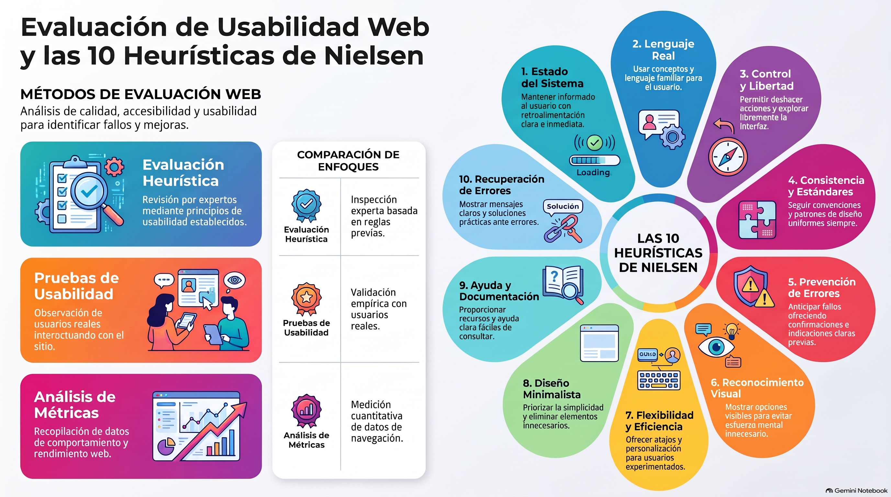

# Semana 6 — Comprendiendo un test heurístico
**Prototipos Navegables (DUD2204) · Experiencia 3**
**Clase sincrónica:** Miércoles 25 de noviembre de 2026 · 19:00 hrs

---



---

> 🎨 **Tutorial práctico de la semana:** [tutorial-figma.md](tutorial-figma.md) — cómo registrar y priorizar hallazgos heurísticos dentro de Figma.

---

## Introducción

Esta semana iniciamos la **Experiencia 3**: veremos cómo **evaluar y mejorar** nuestros diseños. Para medir la usabilidad y la accesibilidad de un sitio web existen diversas herramientas y técnicas:

- **Pruebas con usuarios reales**, para evaluar la facilidad de uso y de navegación.
- **Herramientas de análisis de datos**, para medir el tiempo de carga, la tasa de rebote y otros indicadores.
- Las **directrices de accesibilidad web**, para asegurar que el sitio sea accesible para todas las personas, independientemente de sus capacidades físicas o cognitivas.

La usabilidad y la accesibilidad son aspectos clave: hay que trabajarlas **de manera constante**, no solo al final.

> 💡 **Preguntas activadoras**
> - ¿Qué es un test heurístico?
> - ¿Para qué sirve un test heurístico?
> - ¿Cómo aplicar las 10 reglas heurísticas de Nielsen?

---

## Resultado de Aprendizaje e Indicadores de Logro

**RA1.** Implementar prototipo interactivo de un proyecto digital, considerando códigos gráficos y elementos de usabilidad y accesibilidad.

| IL | Indicador |
|----|-----------|
| **IL6** | Aplica test heurístico en el diseño de interfaz, para evaluar la usabilidad y la experiencia del usuario en la navegación. |
| **IL7** | Implementa cambios a partir de los resultados del testeo para la mejora del diseño de interfaz. |

---

## Conceptos Clave de la Semana

`Test heurístico` · `Usabilidad` · `Evaluación` · `Pautas de accesibilidad` · `Accesibilidad` · `Mejoras de prototipos`

---

## Contenidos

### 1. Evaluación de diseño de sitios web

Es un **proceso sistemático y objetivo** para analizar y medir la calidad, la usabilidad y la efectividad de un sitio. Busca identificar **fortalezas, debilidades y oportunidades de mejora**, para optimizar la experiencia del usuario y cumplir los objetivos del sitio.

| Método | En qué consiste | ¿Requiere usuarios? |
|--------|-----------------|:-------------------:|
| **Evaluación heurística** | Revisión experta del sitio con una lista de heurísticas o principios de usabilidad. Se buscan violaciones y se proponen mejoras. | ❌ |
| **Pruebas de usabilidad** | Observar a usuarios reales haciendo tareas. Pueden ser **moderadas** (con facilitador) o **no moderadas** (sin facilitador). Se registran problemas, tiempos e impresiones. | ✅ |
| **Análisis de métricas y datos** | Datos de comportamiento con herramientas de analítica: tiempos de carga, tasa de rebote, páginas visitadas. | Indirecto |
| **Revisión de contenido** | Calidad y relevancia: precisión, organización, legibilidad, coherencia y adecuación al público. | ❌ |
| **Evaluación de accesibilidad** | Cumplimiento de estándares como las WCAG, para personas con discapacidad visual, auditiva, cognitiva o motora. | ❌ |
| **Evaluación de SEO** | Posicionamiento en buscadores: estructura de URL, metadatos, palabras clave e indexación. | ❌ |

> 💡 Conviene **combinar métodos** según los objetivos y el público del sitio, y usar los resultados para tomar decisiones informadas sobre diseño, usabilidad y contenido.

---

### 2. ¿Qué es la evaluación heurística?

Un **test heurístico** es una técnica de evaluación de usabilidad que identifica posibles problemas en el diseño de una interfaz mediante una **revisión sistemática y exhaustiva**, usando una lista de **heurísticas**: reglas generales para detectar problemas comunes de usabilidad.

- Lo hace un **evaluador experto**, con su conocimiento y experiencia en diseño de interfaces.
- Puede usar heurísticas ampliamente aceptadas (como las de Nielsen) o **adaptarlas** al proyecto.
- Busca problemas de **navegación**, estructura de la información, **legibilidad**, consistencia visual, **retroalimentación** al usuario y facilidad de uso.
- Al terminar, se **documentan** los problemas y se **clasifican según su gravedad**. Con eso se priorizan las correcciones.

> ⚠️ **Importante:** el test heurístico es útil y eficiente porque detecta problemas **sin involucrar usuarios reales**. Pero **no reemplaza** las pruebas con usuarios, que revelan problemas y perspectivas que una revisión experta no ve. Lo recomendable es **combinar técnicas**.

---

### 3. Las 10 heurísticas de Nielsen

Desarrolladas por **Jakob Nielsen** en los años 90, son conocidas como las «10 reglas de oro» del diseño de interfaces. La guía las ilustra con ejemplos reales:

| # | Heurística | Qué pide | Ejemplo de la guía |
|---|-----------|----------|-------------------|
| 1 | **Visibilidad del estado del sistema** | Informar siempre qué está pasando, con feedback claro. | Barra de progreso al subir un archivo a Google Drive. |
| 2 | **Correspondencia entre el sistema y el mundo real** | Lenguaje y conceptos familiares para el usuario. | La página 404 de Netflix («Lo sentimos, la página que buscas no existe») frente a una página de error sin diseño. |
| 3 | **Control y libertad del usuario** | Poder deshacer y navegar con libertad. | «Deshacer» después de enviar un correo en Gmail. |
| 4 | **Consistencia y estándares** | Mismas convenciones, misma presentación y mismo comportamiento. | Menú de LinkedIn: mal ejemplo con un solo ícono a color; buen ejemplo con todos iguales. |
| 5 | **Prevención de errores** | Anticiparse con indicaciones, confirmaciones y restricciones; si el error ocurre, un mensaje que explique cómo corregirlo. | Gmail: «Especifica al menos un destinatario». |
| 6 | **Reconocimiento en lugar de recuerdo** | Mostrar la información y las opciones; no obligar a recordar. | Ícono de carrito con texto en Mercado Libre («Carrito») y Falabella («Canasta»). |
| 7 | **Flexibilidad y eficiencia de uso** | Personalización y atajos para usuarios experimentados. | Arrastrar y soltar archivos y carpetas en Google Drive. |
| 8 | **Estética y diseño minimalista** | Diseño limpio, sin elementos innecesarios. | La interfaz simple de ChatGPT. |
| 9 | **Ayuda y documentación** | Ayuda fácil de buscar, entender y usar. | Preguntas frecuentes de Mailchimp. |
| 10 | **Recuperación de errores** | Mensajes de error claros y específicos, con soluciones sugeridas. | Página de Mailchimp al llegar a una URL que no existe. |

> 📌 La guía presenta las reglas 9 y 10 en este orden. En la lista oficial de Nielsen Norman Group, la n.º 9 es «Ayudar a reconocer, diagnosticar y recuperarse de errores» y la n.º 10 es «Ayuda y documentación». Al documentar, **nombra la heurística**, no solo el número.

> 🔗 [10 heurísticas de usabilidad (Nielsen Norman Group)](https://www.nngroup.com/articles/ten-usability-heuristics/) · [10 reglas heurísticas y cómo aplicarlas (UI from Mars)](https://www.uifrommars.com/10-reglas-heuristicas-como-aplicarlas/) · Videos del canal de NN/g en YouTube (en inglés, con subtítulos), comenzando por «Usability Heuristic 1: Visibility of System Status».

---

### 4. Cómo documentar y priorizar (complemento)

Estos elementos no están en la guía de esta semana, pero los usarás en las semanas 7 y 8:

**Escala de severidad de Nielsen**

| Nivel | Descripción | Prioridad |
|-------|-------------|-----------|
| **0** | No es un problema de usabilidad | Ignorar |
| **1** | Cosmético | Solo si hay tiempo |
| **2** | Menor | Baja |
| **3** | Mayor | Corregir antes de publicar |
| **4** | Catastrófico | Corregir sí o sí antes de publicar |

**¿Cuántos evaluadores?** Según Nielsen, una persona encuentra cerca del **35 %** de los problemas y cinco personas, cerca del **75 %**. Por eso se recomiendan **entre 3 y 5** evaluadores.

**Registro de un hallazgo:**
```
ID:            H1
Heurística:    n.º y nombre
Elemento:      componente o sección
Descripción:   qué está mal y por qué afecta al usuario
Severidad:     0 a 4
Propuesta:     cómo corregirlo, de forma específica
```

> 🔗 Plantilla para análisis heurísticos de **Torres Burriel**, que usarás en la semana 7: [torresburriel.com](https://www.torresburriel.com)

---

## Actividad de la Semana

> 📝 **AF4: Utilizando las reglas de Nielsen para evaluar una interfaz** · Cuestionario en AVA

Leerás y analizarás una situación sobre la evaluación de una **plataforma de cursos en línea (e-learning)** y responderás cómo se aplican las reglas heurísticas de Nielsen a su diseño. Evaluarás elementos clave de la interfaz: navegación, diseño visual, claridad de la información y otros aspectos que influyen en la efectividad y la satisfacción del usuario.

- 📅 **Fecha límite:** Lunes 30 de noviembre de 2026 a las 23:59 hrs
- 📤 **Entrega:** Cuestionario directo en AVA (sin archivo)

---

## Cierre de Semana

Comprender las reglas heurísticas de Nielsen es clave para diseñar interfaces efectivas y satisfactorias. Al aplicarlas durante el diseño podemos **anticipar** dificultades y tomar decisiones informadas que mejoran la usabilidad, la eficiencia y la satisfacción.

También nos ayudan a encontrar áreas de mejora en la estructura de la información, la navegación, la legibilidad, la consistencia visual y otros aspectos clave. El resultado: menos fricción, tareas más fáciles, usuarios más satisfechos, más retención de visitantes y más probabilidades de éxito del producto.

---

## Referencias de la guía

- Busquets, C. (s.f.). *10 reglas heurísticas de Nielsen y cómo aplicarlas.* UI from Mars. [uifrommars.com](https://www.uifrommars.com/10-reglas-heuristicas-como-aplicarlas/)
- Nielsen, J. (2020). *10 Usability Heuristics for User Interface Design.* Nielsen Norman Group. [nngroup.com](https://www.nngroup.com/articles/ten-usability-heuristics/)
- Torres Burriel, D. (2008). *Plantilla para hacer análisis heurísticos de usabilidad.* torresburriel.com

---

[📄 Ver Presentación de la Clase](material-clase/presentacion.pdf)
