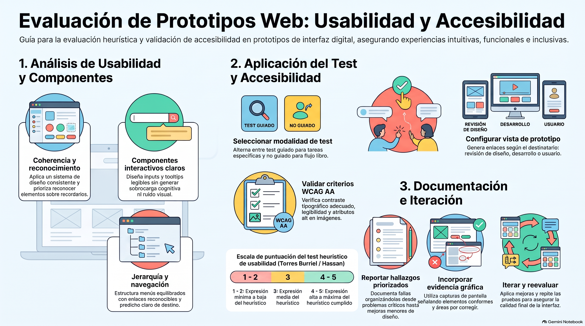

# Semana 7 — Identificando elementos a evaluar con test heurístico y criterios de accesibilidad
**Prototipos Navegables (DUD2204) · Experiencia 3**
**Clase sincrónica:** Miércoles 2 de diciembre de 2026 · 19:00 hrs

---

---

> 🎨 **Tutorial práctico de la semana:** [tutorial-figma.md](tutorial-figma.md) — preparar el prototipo para testear, compartirlo, hacer el test con personas y revisar la accesibilidad en Figma.

---

## Introducción

Esta semana aprenderemos a crear una **lista de evaluación** para probar nuestros prototipos con las 10 heurísticas de Nielsen, incluyendo los elementos clave del proyecto: sus objetivos, su nombre y su estructura.

Aprenderemos a aplicar un **test guiado** y uno **no guiado** para obtener retroalimentación de los usuarios. Usaremos la **plantilla de test heurístico de Torres Burriel** y aprenderemos a elegir las herramientas del software de diseño para **presentar el prototipo** a usuarios y clientes y recibir su feedback.

También evaluaremos las **pautas y criterios de accesibilidad** del prototipo y, al final, aprenderemos a **documentar los resultados**.

> 💡 **Preguntas activadoras**
> - ¿Para qué sirve un test heurístico?
> - ¿Cuáles son los elementos clave que debemos sumar a nuestro test?
> - ¿Cuál es la pauta de accesibilidad que debemos seguir para testear nuestro diseño de interfaz?

---

## Resultado de Aprendizaje e Indicadores de Logro

**RA1.** Implementar prototipo interactivo de un proyecto digital, considerando códigos gráficos y elementos de usabilidad y accesibilidad.

| IL | Indicador |
|----|-----------|
| **IL1** | Utiliza componentes para el diseño de una interfaz interactiva, de acuerdo a la experiencia de usuario y requerimientos del proyecto. |
| **IL2** | Utiliza elementos gráficos para la correcta composición de un diseño de interfaz, aplicando interacciones y considerando elementos de accesibilidad y usabilidad. |
| **IL3** | Implementa una maqueta de interfaz responsiva para múltiples dispositivos, según los requerimientos del proyecto. |
| **IL4** | Aplica guía de estilo, considerando criterios de accesibilidad y usabilidad. |
| **IL5** | Compone prototipo interactivo, considerando elementos de accesibilidad y usabilidad. |
| **IL6** | Aplica test heurístico en el diseño de interfaz, para evaluar la usabilidad y la experiencia del usuario en la navegación. |
| **IL7** | Implementa cambios a partir de los resultados del testeo para la mejora del diseño de interfaz. |

---

## Conceptos Clave de la Semana

`Test heurístico` · `Usabilidad` · `Evaluación` · `Mejoras de prototipos` · `Accesibilidad`

---

## Contenidos

### 1. Testeando el diseño de interfaz: la lista de evaluación

Para evaluar un diseño creamos un **checklist** con los elementos a revisar. A partir de los principios de Nielsen, **Yusef Hassan** (revista *No Solo Usabilidad*) estableció criterios de evaluación por categorías. Algunas preguntas de cada una:

| Categoría | Preguntas de ejemplo |
|-----------|---------------------|
| **Generales** | ¿Los objetivos del sitio son concretos y están bien definidos? ¿Los contenidos y servicios corresponden a esos objetivos? ¿La estructura está orientada al usuario? ¿El *look & feel* corresponde a los objetivos? ¿El diseño es coherente y reconocible? |
| **Identidad e información** | ¿Se muestra la identidad de la empresa en todas las páginas? ¿El logotipo es significativo y visible? ¿El eslogan expresa qué es la empresa? ¿Hay mecanismos de contacto? ¿Se informa sobre protección de datos y derechos de autor? |
| **Lenguaje y redacción** | ¿El sitio habla el mismo lenguaje que sus usuarios? |
| **Rotulado** | ¿Los rótulos son significativos y estándar? ¿Hay un único sistema de organización, claro? ¿Los títulos de página están bien planificados? |
| **Estructura y navegación** | ¿La organización es la adecuada, con equilibrio entre profundidad y anchura? ¿Los enlaces se reconocen e indican su estado? ¿Los menús evitan la sobrecarga? ¿Hay elementos que indican dónde estoy y cómo volver? ¿Se evitó la redundancia de enlaces? |
| **Lay-out de la página** | ¿Lo más relevante está en las zonas de mayor jerarquía? ¿Se evitó la sobrecarga informativa y el ruido visual? ¿Hay espacios en blanco para descansar la vista? ¿Se usa bien la jerarquía visual? ¿Se controló el largo de la página? |
| **Búsqueda** | ¿Es fácil de encontrar y de reconocer? ¿Permite búsqueda avanzada? |
| **Elementos multimedia** | ¿Las fotos están bien recortadas y con buena resolución? ¿Las metáforas visuales se entienden? ¿Las imágenes y animaciones aportan valor? ¿Se evitaron las animaciones cíclicas? |
| **Ayuda** | ¿La sección de ayuda es necesaria y está en una zona visible? ¿Hay ayuda contextual en tareas complejas? ¿Las FAQ están bien elegidas y redactadas? |
| **Accesibilidad** | ¿El tamaño de fuente es relativo o suficientemente grande? ¿La tipografía, el ancho de línea y la alineación facilitan la lectura? ¿Hay alto contraste entre texto y fondo? ¿Las imágenes tienen `alt`? ¿Se ve bien en distintas resoluciones? ¿Se puede imprimir? |
| **Control y retroalimentación** | ¿El usuario tiene el control? ¿Se le informa lo que está pasando y lo que pasó? ¿Los errores se explican de forma clara, no alarmista y con solución? ¿Tiene libertad para actuar? |

> 🔗 [Guía de Evaluación Heurística de Sitios Web — No Solo Usabilidad](http://www.nosolousabilidad.com/articulos/heuristica.htm)

---

### 2. Consideraciones al diseñar y testear

| Elemento clave | Qué revisar | Ejemplo de la guía |
|----------------|-------------|-------------------|
| **Coherencia con la línea gráfica del sistema** | Que el proyecto siga el sistema de diseño establecido. | El ícono de compartir de WhatsApp y Facebook: varían en color o tamaño, pero comparten lógica. |
| **Reconocer antes de recordar** | Íconos y etiquetas fáciles de reconocer y navegación sencilla, con varias formas de encontrar lo que se busca. | Uber Eats. |
| **Controles de entrada (inputs)** | Botones, campos de texto, listas desplegables y campos de fecha fáciles de encontrar, usables y accesibles. | Buscadores de Gmail y LinkedIn. |
| **Componentes informativos** | Tooltips, notificaciones y barras de progreso que informan el estado, **sin abusar** de ellos. | Tooltip del sitio del Volkswagen up!. |
| **Componentes de navegación** | Campos de búsqueda, íconos y etiquetas (*tags*) que ayudan a moverse, filtrar y clasificar. | Barra de navegación de Instagram. |

---

### 3. Herramientas para testear el prototipo

La guía muestra el **panel Compartir** de Adobe XD. En **Figma** las mismas opciones están en el botón **Compartir / Share** y en la vista **Presentar**:

| Vista (guía) | Para qué sirve | En Figma |
|--------------|----------------|----------|
| **Revisión del diseño** | Que el equipo o el cliente comenten el avance. | Compartir el **archivo** con permiso para comentar; **comentarios** (tecla C). |
| **Desarrollo** | Que el equipo de desarrollo extraiga recursos y medidas. | **Dev Mode** y la sección Exportar. |
| **Presentación** | Mostrar el diseño a pantalla completa, sin distracciones. | **Presentar** (▶) y enlace del prototipo. |
| **Test de usuario** | Que el usuario pruebe y dé feedback. | **Enlace del prototipo** con el flujo de la tarea como punto de inicio. |
| **Personalizada** | Agregar contraseña o ajustar lo que se comparte. | Configuración de acceso del enlace (según el plan). |

**Pasos para compartir:** abrir **Compartir** → elegir el **flujo** que se va a probar → elegir qué se comparte (archivo o prototipo) → configurar **quién puede verlo** (por ejemplo, «Cualquier persona con el enlace · Puede ver») → **copiar el enlace**.

> 💡 Para probarlo en un celular, usa la app de Figma (iOS o Android).

---

### 4. Aplicación del test heurístico: guiado y no guiado

| | Test guiado | Test no guiado |
|--|------------|----------------|
| **Cómo es** | El equipo de diseño **guía** por dónde debe navegar el usuario. | Se explica el **contexto**, pero **no se guía**: se observa y se toma nota de todo lo que hace y no hace. |
| **Para qué sirve** | Averiguar cómo funciona una **sección puntual** o un elemento. Más focalizado, aunque puede cubrir todo el prototipo. | Ver cómo avanza el flujo, **dónde se estanca** y dónde la navegación es más fácil. |
| **Recomendación** | Definir de antemano las secciones o tareas a revisar. | **Grabar** la sesión para rescatar después lo que no se alcanzó a observar. |

**La plantilla de Torres Burriel:** el estudio Torres Burriel desarrolló un **test que permite puntuar** el prototipo, basado en los criterios de Yusef Hassan. Se aplica así:
1. Descargar la plantilla y **completar los datos del proyecto**.
2. Revisar cada **pregunta de cotejo** mientras se prueba el prototipo.
3. **Asignar una puntuación** a cada elemento o pregunta.

> 🔗 [Plantilla para hacer análisis heurísticos de usabilidad — Torres Burriel](https://torresburriel.com/weblog/plantilla-para-hacer-analisis-heuristicos-de-usabilidad/) · Video (en inglés): [Heuristic Evaluation of User Interfaces](https://www.youtube.com/watch?v=6Bw0n6Jvwxk)

---

### 5. Aplicación de los criterios de accesibilidad

A los elementos clave de la lista de evaluación se les aplica la **tabla de cotejo de las WCAG**, revisando punto a punto según el **marco legal chileno**: un sitio debe cumplir al menos el **nivel AA** para considerarse accesible.

> 🔗 Tabla de cotejo de las WCAG para el nivel AA en el CRAED: [craed.cl/criterios-de-accesibilidad](https://craed.cl/criterios-de-accesibilidad/)

**Revisiones prácticas en Figma** (complemento):
- **Contraste:** un plugin de contraste o el [WebAIM Contrast Checker](https://webaim.org/resources/contrastchecker/). Texto normal ≥ 4,5:1; texto grande ≥ 3:1.
- **Áreas táctiles:** botones, chips y links de al menos 44 × 44.
- **Texto alternativo** anotado en cada imagen; las decorativas, declaradas como tales.
- **Información no solo por color**, **foco visible** y **mensajes de error** claros.

---

### 6. Documentación de los resultados

Los resultados se presentan en un **informe**, que siempre debe tener:

| Sección | Qué incluye |
|---------|-------------|
| **Introducción** | Qué se analizó, qué pruebas se hicieron, qué herramientas se usaron para el test heurístico y la evaluación de accesibilidad, y un resumen de los hallazgos. |
| **Explicación del contexto** | Por qué y para qué se hicieron las pruebas. |
| **Hallazgos más importantes** | Lista ordenada por prioridad: de los más críticos a los más fáciles de corregir. |
| **Lista del test heurístico** | El test completo, con todas sus aristas. |
| **Lista de cotejo de accesibilidad** | La tabla completa del análisis. |
| **Lo que cumple y lo que necesita mejoras** | Tablas o gráficos, y **capturas** que muestren visualmente qué está mal y qué cumple. |

> 🔁 **Iteración y mejora continua:** las pruebas son un proceso iterativo. Después de mejorar, hay que **volver a probar** para confirmar que el sitio es accesible.

---

## Actividad de la Semana

> 📝 **AF5: Evaluando nuestro prototipo** · Actividad formativa con formato de respuesta

Aplica las **10 heurísticas de Nielsen** y los **criterios de accesibilidad** a tu prototipo de la tienda. Revisa **cada página interior (mínimo 5 y máximo 10)** y evalúa cómo se cumplen en cada elemento del diseño. Documenta los hallazgos y las mejoras propuestas en un **breve reporte**, usando el mismo formato de respuesta de la actividad.

**Estructura del reporte:**
1. **Introducción:** el proyecto, su objetivo y la metodología de la evaluación heurística y de accesibilidad.
2. **Explicación del contexto** en que se hizo la evaluación.
3. **Hallazgos más importantes**, en orden de prioridad (los críticos primero).
4. **Test heurístico completo** que usaste, adjunto.
5. **Tabla de cotejo de accesibilidad** que usaste, con los criterios revisados en cada elemento.
6. **Elementos que cumplen y elementos que necesitan mejoras**, con tablas o gráficos, y **cómo implementarías los cambios**.
7. **Conclusiones:** hallazgos principales, recomendaciones y su impacto en la usabilidad y la accesibilidad.

**Entrega (ambos al AVA):**
1. El **formato de respuesta** completo, con el **enlace de revisión** del diseño.
2. **ZIP** con el archivo del proyecto.

- 📅 **Fecha límite:** Lunes 7 de diciembre de 2026 a las 23:59 hrs
- ⚠️ Tiene rúbrica.

---

## Cierre de Semana

Mostrar los resultados de los tests heurísticos y de accesibilidad es parte esencial del trabajo de quien diseña interfaces. Esta semana:

- Exploramos el test heurístico de Nielsen y los **criterios de accesibilidad** para evaluar el diseño.
- Creamos **listas de evaluación** y aplicamos el test a nuestros prototipos.
- Aprendimos a identificar los elementos clave: objetivos del proyecto, **coherencia con la línea gráfica** y una interfaz fácil de navegar y de recordar.
- Usamos las herramientas de **compartir** para mostrar el diseño al equipo o al cliente y recibir feedback.
- Aplicamos el test **guiado** (aspectos específicos) y **no guiado** (observar el flujo de navegación).

Dominar el test heurístico y los criterios de accesibilidad garantiza la calidad y la usabilidad de nuestros proyectos y mejora la experiencia de los usuarios.

---

## Referencias de la guía

- Hassan, Y. y Martín, F. (2003). *Guía de Evaluación Heurística de Sitios Web.* No Solo Usabilidad. [nosolousabilidad.com](http://www.nosolousabilidad.com/articulos/heuristica.htm)
- Núñez, M. (2021). *Usabilidad y accesibilidad.* Biblioteca Duoc UC. [craed.cl/usabilidad](https://craed.cl/usabilidad/)

---

[📄 Ver Presentación de la Clase](material-clase/presentacion.pdf)
