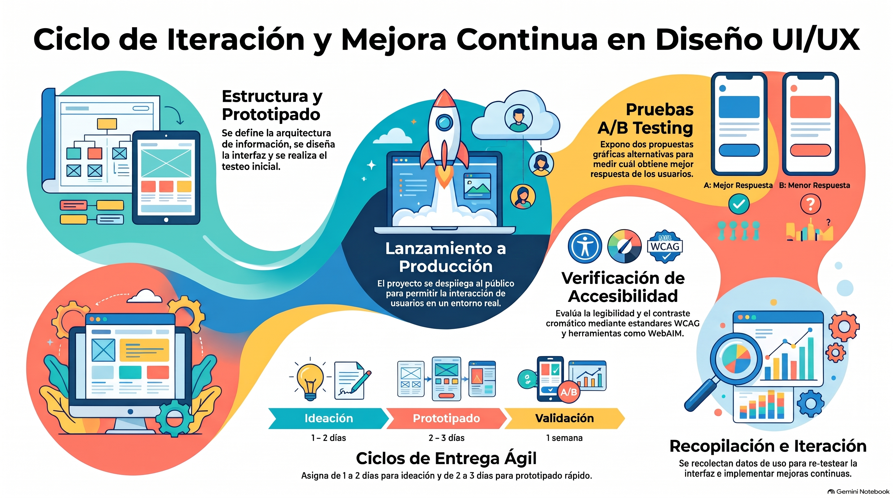

# Semana 8 — Importancia de la iteración y mejora en un diseño de interfaz
**Prototipos Navegables (DUD2204) · Experiencia 3**
**Clase sincrónica:** Miércoles 9 de diciembre de 2026 · 19:00 hrs

---



---

> 🎨 **Tutorial práctico de la semana:** [tutorial-figma.md](tutorial-figma.md) — guardar el «antes», corregir desde el sistema de diseño, crear patrones de feedback y armar el A/B test en Figma.

---

## Introducción

Esta semana aprenderás a **aplicar las mejoras** encontradas en el test heurístico: a identificar áreas de mejora en tus diseños y a implementar soluciones efectivas para la usabilidad y la experiencia del usuario.

Luego exploraremos el concepto de **iteración**: qué es, por qué es una herramienta poderosa para perfeccionar continuamente los proyectos y **cuándo** es el momento adecuado para iterar.

También profundizaremos en las **mejoras de accesibilidad**, para que tus interfaces sean más inclusivas para todas las personas, independientemente de sus habilidades o de los dispositivos que usen.

> 💡 **Preguntas activadoras**
> - ¿Qué es iterar?
> - ¿Cuándo debemos iterar un proyecto?

---

## Resultado de Aprendizaje e Indicadores de Logro

**RA1.** Implementar prototipo interactivo de un proyecto digital, considerando códigos gráficos y elementos de usabilidad y accesibilidad.

| IL | Indicador |
|----|-----------|
| **IL1** | Utiliza componentes para el diseño de una interfaz interactiva, de acuerdo a la experiencia de usuario y requerimientos del proyecto. |
| **IL2** | Utiliza elementos gráficos para la correcta composición de un diseño de interfaz, aplicando interacciones y considerando elementos de accesibilidad y usabilidad. |
| **IL3** | Implementa una maqueta de interfaz responsiva para múltiples dispositivos, según los requerimientos del proyecto. |
| **IL4** | Aplica guía de estilo, considerando criterios de accesibilidad y usabilidad. |
| **IL5** | Compone prototipo interactivo, considerando elementos de accesibilidad y usabilidad. |
| **IL6** | Aplica test heurístico en el diseño de interfaz, para evaluar la usabilidad y la experiencia del usuario en la navegación. |
| **IL7** | Implementa cambios a partir de los resultados del testeo para la mejora del diseño de interfaz. |

---

## Conceptos Clave de la Semana

`Iterar` · `Accesibilidad` · `Evaluación` · `Mejoras de prototipos` · `A/B testing`

---

## Contenidos

### 1. Aplicar las mejoras a partir del test heurístico

Todo proyecto se puede dividir en **6 macroetapas**:

```
A. Arquitectura de la información
B. Diseño de interfaz
C. Testear el diseño
D. Lanzar a producción
E. Recopilar datos de uso
F. Iterar y volver a C
```

Cuando el proyecto ya está en producción, es momento de **recopilar datos**. Con ellos se vuelve a testear y se hacen las mejoras que indiquen los datos y los tests.

> 📌 Las etapas son **flexibles**: un proyecto puede no seguirlas en el mismo orden, o no pasar por todas.

---

### 2. ¿Qué es una iteración?

Una **iteración** consiste en **repetir un proceso para mejorar** un producto o servicio. Un ejemplo claro son las actualizaciones de las apps: **Uber** recopila datos de uso de su app y hace mejoras basadas en ellos. Por ejemplo, simplificó su pantalla de inicio reduciendo la cantidad de elementos.

| Una iteración **es** | Una iteración **no es** |
|----------------------|-------------------------|
| **Basada en evidencia:** responde a un hallazgo, a datos o al feedback de usuarios. | Rehacer todo por gusto personal. |
| **Focalizada:** cambia lo que debe cambiar. | Cambiar lo que funciona bien. |
| **Trazable:** se sabe qué problema resuelve. | Un cambio sin un problema detrás. |
| **Medible:** se puede comprobar si funcionó. | Algo que no se vuelve a probar. |

---

### 3. ¿Cuándo iterar?

Todo proyecto debe considerar una **etapa de iteración al final del proceso**, en la que se recopilan datos para hacer un **test heurístico** o un **A/B testing**, y se mejora el diseño según el feedback y los datos.

Muchas apps obtienen esos datos de los **comentarios y valoraciones** de sus usuarios: en las apps de entrega de comida evaluamos el servicio, y con eso las empresas iteran y mejoran.

La iteración es **constante**: hay que hacer pruebas para medir la satisfacción de los usuarios.

**¿Cuánto dura un ciclo?** No hay una respuesta única, pero **una semana** es un punto de partida razonable. La **agilidad** es clave: una vez encontrados los hallazgos, hay que pasar rápido a idear.

| Fase | Duración aproximada |
|------|---------------------|
| **Ideación** (generar y explorar ideas) | 1 a 2 días |
| **Prototipado** (materializar las ideas en diseños y prototipos) | 2 a 3 días |

> Los tiempos son flexibles y se adaptan a cada proyecto.

---

### 4. A/B testing

Una de las formas más eficientes de probar es el **A/B testing**: se expone a los usuarios a **dos interfaces con los mismos elementos, pero con diseños gráficos distintos**, para ver cómo reaccionan a cada propuesta y cuál tiene **mejor recibimiento**.

**En la AS3:**
- **Variante A:** el diseño **actual** (el que evaluaste en la semana 7).
- **Variante B:** el diseño **mejorado** con las áreas de mejora identificadas.

**Cómo prepararlo en Figma:**
1. Pon las dos variantes en frames paralelos: `Versión A` y `Versión B`.
2. Crea un **flujo** para cada una: `Flujo A` y `Flujo B`.
3. Define la **tarea** y la **métrica** (por ejemplo, completar la compra, tiempo, clics o pasos).
4. Comparte cada flujo con usuarios distintos, o usa una **herramienta de pruebas A/B** que se conecte con prototipos de Figma, para recopilar **datos cuantitativos**.
5. Compara los resultados y decide.

> 💡 **Consejo:** si quieres saber **qué cambio** produjo la mejora, prueba **un cambio a la vez**. Si cambias varias cosas entre A y B, sabrás qué versión funciona mejor, pero no exactamente por qué.

> 🔗 [A/B testing (Nielsen Norman Group)](https://www.nngroup.com/videos/ab-testing-roadmap/) · Blog IDA: [Consideraciones para realizar test A/B exitosos](https://blog.ida.cl/diseno/consideraciones-realizar-test-ab-exitosos/) · [Entendiendo los test A/B](https://blog.ida.cl/diseno/por-que-nos-gustan-los-test-ab/)

---

### 5. ¿Cómo aplicar las mejoras de accesibilidad?

En cada iteración hay que buscar **mejorar la accesibilidad** a partir de los hallazgos. Una de las mejoras más importantes para la legibilidad es el **contraste**. Recuerda también lo aprendido sobre **espaciado y tamaños de texto** (semana 4).

| Herramienta | Para qué sirve |
|-------------|----------------|
| [Comprobador de contraste de WebAIM](https://webaim.org/resources/contrastchecker/) | Evaluar si dos colores cumplen las pautas de contraste. |
| [Checklist WCAG de WebAIM](https://webaim.org/standards/wcag/checklist) | Verificar que se alcanza el nivel de cumplimiento deseado. |

**Cómo aplicarlas en Figma** (complemento): corrige en el **sistema de diseño**, no en cada pantalla. Si cambias la **variable** de un color o el **componente** de un botón, la mejora llega a todas las páginas.

| Problema | Solución en Figma |
|----------|------------------|
| Contraste insuficiente | Cambiar el valor de la variable de color y verificar con WebAIM. |
| Espaciado de texto apretado | Ajustar interlineado y espacio entre párrafos en los estilos de texto. |
| Área táctil pequeña | Llevar el componente a 44 × 44 como mínimo. |
| Sin indicador de foco | Variante `Foco` con un borde visible. |
| Información solo por color | Agregar ícono o texto al componente. |

---

## Actividad de la Semana

> 📝 **AS3: Aplicando el proceso de iteración** · Actividad sumativa

Continúa con el prototipo de la **tienda de distribución de productos Apple** y **mejora la experiencia** usando la evaluación heurística de la semana 7. Harás un **A/B test** que compare el diseño actual con el mejorado.

**Pasos del enunciado:**
1. Analiza los resultados de la evaluación de la semana 7 e identifica las áreas que requieren mejoras.
2. Diseña un **plan de A/B test**: qué elementos implementarás en la variante **B**.
3. Revisa el **contraste** y el **espaciado de texto**, para cumplir los criterios de accesibilidad.
4. Crea la **variante B** mejorada, con buenas prácticas y criterios de accesibilidad.
5. Usa una **herramienta de pruebas A/B** para recopilar **datos cuantitativos** de ambas variantes.
6. Analiza los datos: ¿la variante B fue más efectiva en usabilidad y experiencia?
7. Comparte la variante B con **usuarios reales** y recopila información **cualitativa** (usabilidad, accesibilidad y otros aspectos).
8. Usa ese feedback para hacer **ajustes finales**.
9. Integra todo en un **breve reporte**: cómo abordaste los problemas, cómo implementaste las mejoras y cómo integraste los comentarios. Puedes incluir capturas comparativas, gráficos del A/B test y ejemplos de feedback.

**Entrega (ambos al AVA):**
1. **ZIP** con el archivo del proyecto.
2. El documento con el reporte y el **enlace de revisión** del diseño.

- 📅 **Fecha límite:** Lunes 14 de diciembre de 2026 a las 23:59 hrs
- ⚠️ Es **sumativa**: revisa la rúbrica.

---

## Cierre de Semana

¡Llegaste a la última semana de aprendizaje! Esta semana nos enfocamos en **aplicar las mejoras** del test heurístico y en la **iteración**, el proceso que nos permite seguir mejorando a medida que recibimos feedback y hacemos ajustes. Vimos **cuándo** iterar para adaptar las interfaces a las necesidades cambiantes de los usuarios, y cómo aplicar **mejoras de accesibilidad** para crear interfaces inclusivas.

Ahora te invitamos a poner en práctica todo lo aprendido: usa el test heurístico y la iteración para mejorar la calidad y la usabilidad de tus diseños, y aplica las mejoras de accesibilidad para llegar a más personas. El diseño de interfaces es un camino de aprendizaje constante.

---

## Referencias de la guía

- WebAIM (s.f.). *WCAG Checklist.* [webaim.org](https://webaim.org/standards/wcag/checklist)
- Soria, M. (s.f.). *Diseño iterativo: ¿qué es y por qué deberías aplicarlo?* Medium.
- Brandwarm (s.f.). *Accesibilidad en tu web: ¿por qué deberíamos implementarla?* Medium.
- Brandwarm (s.f.). *Hablemos sobre cómo abordar proyectos y cómo los procesos son importantes.* Medium.
- Brandwarm (s.f.). *Hablemos de neumorfismo y accesibilidad.* Medium.

---

[📄 Ver Presentación de la Clase](material-clase/presentacion.pdf)
